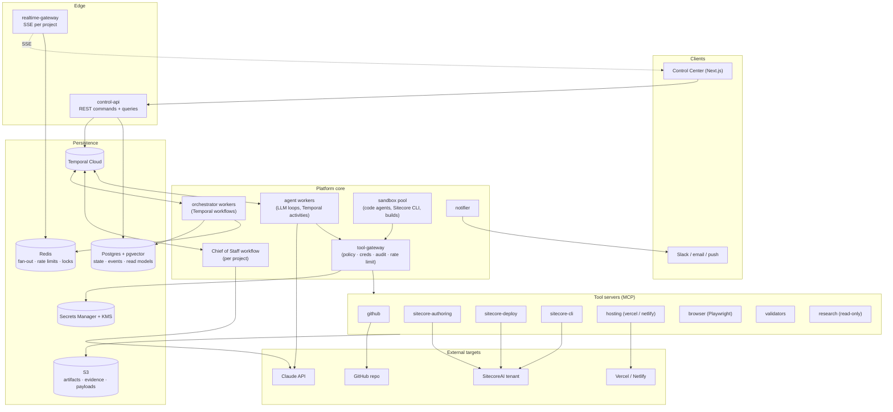
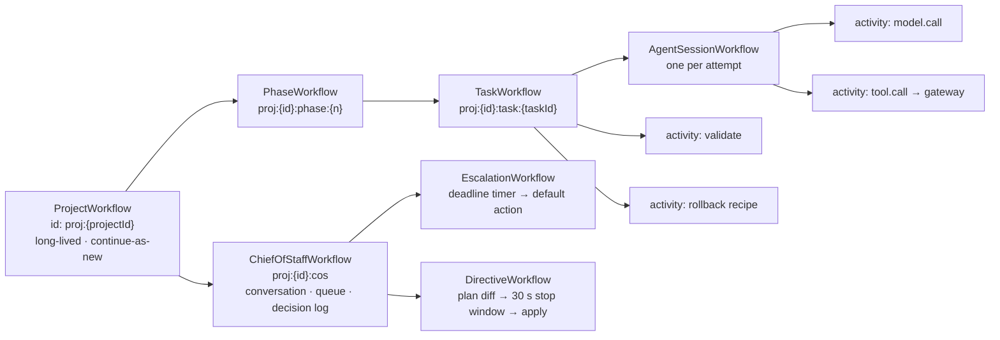
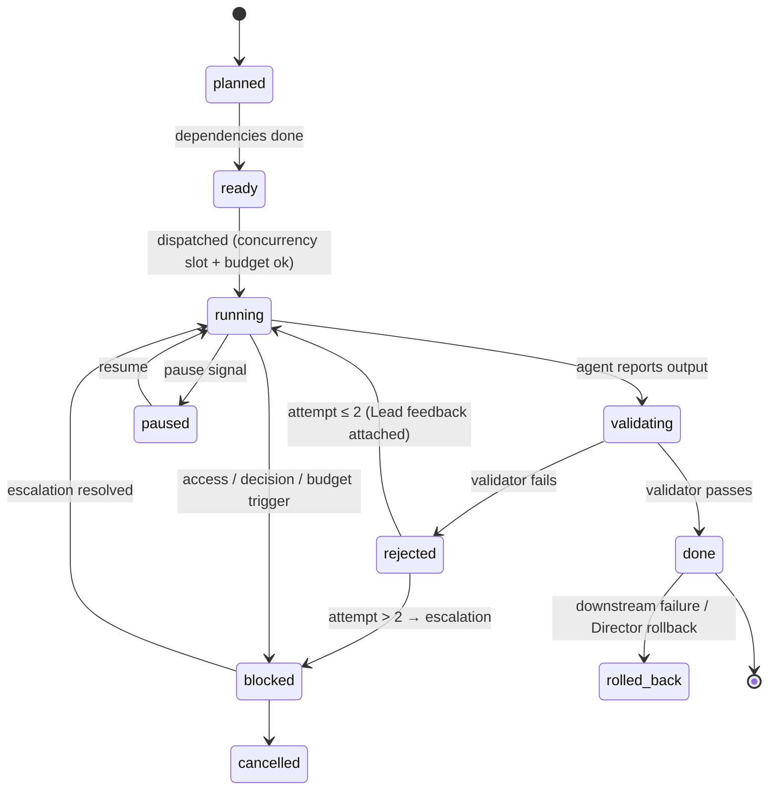

# Launchworks — Backend, Architecture & Build Plan

_Status: proposal for review · 2026-10-22 · Companion to the two source specs:_
_[Requirements & Technical Architecture](https://claude.ai/artifact/PxHxU9S1KjYcpcuktN46f7) and
[Control Center Design Requirements](https://claude.ai/artifact/43ybuCVtG7tjNd68SXDeLR)._

**The plan in one paragraph.** Build Launchworks as a **multi-tenant agent delivery platform**, and treat
the SitecoreAI replatform as its **first playbook**, not as the whole product. The platform core knows
nothing about Sitecore. It owns projects, the plan tree, durable orchestration (Temporal), the agent
runtime, a policy-enforcing tool gateway, escalations, the event log, and budgets. Everything
Sitecore-specific is versioned configuration plus tool servers: phases, gates, roles, prompts, skills,
validators and templates. That split is what makes "many projects, run continuously" work. You can run
fifty concurrent engagements, improve the playbook between them, pin each project to the playbook version
it started on, and later add a second engagement type (an XP→SitecoreAI upgrade, another CMS) without
touching the core. All code is TypeScript in one pnpm/Turborepo monorepo, and everything runs on AWS in a
single region. The first milestone ships the API contract and a **project simulator**, so the Control
Center UI can be built against real event shapes before any agent exists.

---

## 1. Key decisions

| # | Decision | Choice | Why | Change vs. requirements doc |
|---|---|---|---|---|
| A1 | Product shape | Generic platform core + versioned **playbooks** (Sitecore = playbook #1) | Multiple projects and future engagement types without core changes. Satisfies FR-38/39/40 and NFR-13 by construction | Extends §7; doc assumes one domain |
| A2 | Orchestration | **Temporal Cloud**, TypeScript SDK | Durable timers (escalation deadlines, 30 s directive stop window, 10 s undo), signals (gates), retries, resume after crash | Same as doc |
| A3 | Agent loop | Two runtime adapters behind one interface: **Messages API + Tool Runner** (most roles) and **Claude Agent SDK in a sandbox** (code-writing roles). **Managed Agents** evaluated in a spike | Every tool call for item and API work stays under our gateway and audit. Coding roles get a proven coding harness | Refines §7 "Agent runtime" |
| A4 | Tool access | Every tool call goes through one **Tool Gateway**: role allow-list, resource-path scoping, credential injection, rate limits, Step recording, untrusted-content wrapping. MCP servers sit behind it | One policy enforcement point. Agents never see tokens (NFR-01/02/03) | Makes §10 enforceable in one place |
| A5 | Escalation policy | **Deterministic rules in code.** The LLM only writes card text and the recommendation | The policy must be testable and must never "decide" to skip a Director gate | Clarifies §7 "Escalation policy" |
| A6 | Realtime | **REST commands + SSE event stream** with per-project sequence numbers (`Last-Event-ID` resume) | Server→client is one-way. SSE reconnects natively and replays from a cursor, which is exactly the "Catching up" behavior in the design spec | Doc says WebSocket. SSE is simpler and meets the same 2 s budget |
| A7 | Data | Postgres 16 (Aurora) + pgvector; S3; Secrets Manager + per-client KMS keys; Redis (Valkey) | One operational database; cheap durable artifacts; per-client crypto isolation | Same as doc, adds per-client KMS |
| A8 | GitHub access | **GitHub App** installed per client org, short-lived installation tokens | No long-lived PATs; fine-grained, revocable, auditable | Doc says "token" |
| A9 | Models | Opus 5.5 (`claude-opus-5-5`) for Chief of Staff, Architect, Leads; Sonnet 5.5 (`claude-sonnet-5-5`) for specialists; Haiku 5.5 (`claude-haiku-5-5`) for sweeps and classification. All per-role configurable | Matches NFR-12. Current list prices: $4/$20, $2/$10, $0.10/$0.50 per M tokens (in/out) | Concrete IDs |
| A10 | Identity | Microsoft Entra ID (OIDC) for Icreon staff from day one; add WorkOS only if client Observers need their own IdPs | Icreon is on M365; enterprise SSO (GA requirement) at no extra cost | Pulls SSO earlier |

---

## 2. Platform vs. playbook: the multi-project model

```
Workspace (Icreon)
 └─ Client (e.g. Acme Corp)            ← KMS key, GitHub App installation, vault namespace
     └─ Project (Acme corporate site)  ← pins PlaybookVersion; owns budgets, policies, credentials refs
         └─ Run (new | resume | re-run phase)
             └─ Phase → Workstream → Task → Step
```

**Playbook** = a versioned bundle, authored in git under `playbooks/<name>/`, validated in CI, and
published to the database as an immutable `PlaybookVersion`:

| Part | Contents (Sitecore playbook) |
|---|---|
| `playbook.yaml` | Phases 0–10, workstreams, gates (hard/optional), phase dependencies (4 ∥ 5 → 6), the default concurrency |
| `roles/*.yaml` | Chief of Staff, four Leads, seventeen specialists (format in §5.1) |
| `prompts/*.md` | System prompts, referenced by role, hashed into the version |
| `skills/*.md` | Reusable playbooks, e.g. "port a React component to Content SDK" or "register rendering from a Click Click Launch base" |
| `validators/` | Structural rules (SXA/CCL), parity thresholds, Lighthouse targets, as code + config |
| `templates/` | Project templates that pre-fill the Blueprint (FR-40) |
| `tools.yaml` | Which tool servers the playbook needs and their operation catalog |

The rules that make multi-project safe:

- **A project pins its playbook version at intake.** Improvements ship to new projects. A running project
  upgrades only by explicit Director action, and that action is recorded in the Decision Log. This
  satisfies NFR-08: every action ties to "which model and prompt version".
- **Learning flows through the playbook, never through shared runtime memory.** Project A's blackboard is
  never readable by project B. Cross-project improvement works like this: a post-project retro proposes
  skill or prompt diffs, a human reviews them, the eval suite runs (§12), and a new playbook version is
  published. Client data never crosses projects (NFR-14).
- **Promotion ladder for playbook versions:** `draft → eval-passed → canary (one internal project) →
  default`.

---

## 3. System architecture



### 3.1 Deployable services

| Service | Responsibility | Scales on | Notes |
|---|---|---|---|
| `control-api` | Auth, RBAC, queries (snapshots, inspectors), commands → Temporal signals/updates, intake, credential capture → vault | Request rate | Stateless. Fastify + zod. OpenAPI generated from the contracts package |
| `realtime-gateway` | SSE per project; replays from `seq`, then tails Redis Streams | Open connections | Stateless; sticky only for the connection's lifetime |
| `worker-orchestrator` | Project, Phase, Task, Gate, Escalation and Directive workflows | Temporal task-queue backlog | Deterministic workflow code only, no I/O |
| `worker-agents` | Agent loops: model calls, context building, budget metering, Lead reviews | `llm` queue backlog, capped by the global LLM limiter | The CPU-light, I/O-heavy part of the system |
| `sandbox-pool` | Ephemeral containers: repo checkout, `npm`/`next build`, Content SDK CLI, Sitecore CLI (.NET), local editing host, Claude Agent SDK sessions | Concurrent code tasks | Isolation boundary per task; egress allow-list (§10) |
| `tool-gateway` | Policy enforcement point for every tool call (§6) | Calls/sec | Holds no long-lived secrets; mints per-run tokens via the vault |
| `tool-*` servers | One per external system (§6.2) | Per server | MCP over streamable HTTP, private network only |
| `notifier` | Slack, email, web push; deep links back into the Control Center | Events | Consumes the escalation and digest events |
| `projector` (in-process in v1) | Maintains read models from events | Events | Starts as code inside the event-write transaction; split out only if needed |

---

## 4. Orchestration (Temporal)

### 4.1 Workflow hierarchy



- **Each model call and each tool call is its own activity.** Durability is therefore per Step, exactly
  the unit the data model audits. A crashed worker resumes at the next un-acked Step. Retry policy is per
  activity type: back-off on 429/5xx (NFR-06), none on 4xx except auth refresh.
- **Large payloads never enter Temporal history.** Model transcripts, tool responses and inventories go to
  S3 through a claim-check payload codec, and the same codec encrypts with the client's KMS key. That
  keeps history under Temporal's per-workflow limits and keeps client content out of Temporal Cloud in
  plaintext.
- **`ProjectWorkflow` uses continue-as-new at phase boundaries.** Multi-day projects never grow unbounded
  history.
- **Task queues are split by resource:** `orchestration`, `llm`, `tool-io`, `sandbox`, `browser`. Each
  scales on its own backlog.

### 4.2 Signals, updates, queries

| Interaction | Temporal primitive | Target |
|---|---|---|
| Director message / directive | Update (returns the ack with interpreted change and impact) | `ChiefOfStaffWorkflow` |
| Resolve, defer or ask on an escalation | Update | `EscalationWorkflow` |
| Approve or send back a gate | Update (Gate 2 requires a confirmation token from the UI) | `PhaseWorkflow` |
| Pause / resume / cancel at project, phase, workstream, task or agent level | Signal, propagated down the tree | Any level |
| Re-run task or phase; roll back | Update with `dryRun` → impact preview, then commit | `ProjectWorkflow` |
| Status (for the Chief of Staff's structured answer) | Read from read models, not a workflow query | Postgres |

**Pause is cooperative at Step boundaries.** An in-flight model call finishes and its result is kept;
nothing new is dispatched. That matches the design spec ("resume shows what will restart").

**Undo for 10 seconds** (reversible actions) is implemented as a pending command with a 10 s durable
timer. Undo cancels the timer; expiry commits. This puts the design spec's Undo behavior on the server,
where it cannot be lost by a closed tab.

### 4.3 Task state machine (the doc's §9, made executable)



`paused` is added to the doc's machine because the UI must show it distinctly from `blocked`.

### 4.4 Plan compiler and re-planning

- `compile(playbookVersion, blueprintVersion, policies) → PlanTree`. This is a pure function, unit-tested
  with fixtures. Phase 1 compiles a skeleton plan from the playbook alone, so the Plan surface shows the
  whole shape on day one, as the design spec asks. Once the Blueprint is approved, the plan expands to
  one task per component, template and page batch.
- **Directives and Blueprint edits re-compile, then diff.** The diff ("removes 3 templates and 41 pages")
  is what the Chief of Staff shows in its acknowledgement and what Workbench shows beside a Blueprint
  edit. One function serves FR-05, FR-25 and the design spec's impact previews.
- **Rollback is a saga.** Each task records its compensation recipe before any destructive Step
  (NFR-07): created item IDs to delete, the serialization commit to revert. Phase or project rollback
  runs the recipes in reverse topological order.

---

## 5. Agent runtime

### 5.1 Role definition (one file per role; adding a specialist = adding a file)

```yaml
# playbooks/sitecoreai-migration/roles/rendering-registrar.yaml
role: rendering-registrar
tier: specialist
reportsTo: engineering-lead
runtime: messages              # messages | agent-sdk
model: { id: claude-sonnet-5-5, effort: medium }
systemPrompt: prompts/rendering-registrar.md
skills: [register-rendering-from-ccl-base]
tools:
  sitecore-authoring:
    ops: [item.read, item.create, item.update, rendering.create]
    scope:
      paths:
        - "/sitecore/layout/Renderings/Project/{module}/**"
        - "/sitecore/templates/Project/{project}/**"
        - "{sitePath}/Presentation/Available Renderings/**"
  sitecore-cli: { ops: [ser.pull, ser.push, ser.validate] }
  github: { ops: [branch.commit] }
inputs: [blueprint.componentMappings, artifact:component-inventory]
outputs: [rendering-definition]
acceptance: [validator:structural.renderings, validator:editor.component-enabled]
escalateWhen: [rejectedTwice, accessDenied, mappingAmbiguous]
budget: { tokens: 400000, wallclock: 30m }
activePhases: [4]
```

Path scopes are enforced by the gateway (§6). This is how "a Content Migrator cannot touch templates"
becomes a fact rather than a prompt instruction.

### 5.2 Runtime adapters

| Adapter | Used by | How it works |
|---|---|---|
| `messages` | Chief of Staff, Leads, Architect, Analysts, Registrar, Layout Engineer, Migrators, Enabler, Validators, Handover Writer | Anthropic TS SDK Tool Runner (or a manual loop where we need per-turn control). Tools are gateway proxies. Each turn is an activity. Streaming, adaptive thinking, effort from the role file, server-side refusal `fallbacks` enabled |
| `agent-sdk` | Component Engineer, Head Integrator (code in the repo) | Claude Agent SDK runs **inside the task's sandbox** with the repo checked out. Built-in file and edit tools are allowed; Bash goes through an allow-list (`npm`, `npx`, `next`, `sitecore`); external systems are reachable only through MCP pointed at the gateway |
| `managed` (spike) | Candidate for code roles | Claude Managed Agents (beta) with a self-hosted sandbox environment. Adopt only if the M1 spike shows it removes sandbox infrastructure without weakening audit or the gateway |

Both adapters emit the same events (`agent.state`, `step.*`, token usage), so the UI and audit cannot
tell them apart.

### 5.3 Context and cost

- **Cache-friendly prompt layout.** The order is: role system prompt → playbook conventions → frozen
  Platform Notes → the Blueprint slice for this task, all behind cache breakpoints. Per-task specifics
  come last. Specialists running the same role across 40 components then reuse one cached prefix. This
  is the largest single cost lever. Measure it with `cache_read_input_tokens` per role.
- **Specialists are instantiated per task with no carried context** (doc §3). Long-lived context exists
  only for the Chief of Staff and the Leads. Those use server-side compaction, and every Decision Log
  entry is re-injected from Postgres rather than kept in the transcript.
- **Batch API** (50% cheaper) for latency-tolerant sweeps: alt-text generation, content classification,
  parity summaries.
- **Budget ledger.** Every model response's `usage` is written to a per-project ledger. The workflow
  checks the soft (80%) and hard (100%) thresholds before dispatching. A per-task `task_budget` lets
  agents pace themselves.

### 5.4 Blackboard and retrieval

The Blueprint and its mappings live as rows (`mapping` table), not as a blob. Agents read their slice
through a `blackboard` tool. Writes are restricted to the Architect (pre-gate) and the Chief of Staff
(post-directive), and every write creates a new version. Inventories and Platform Notes are embedded into
pgvector, scoped by `project_id`, for retrieval.

---

## 6. Tool layer

### 6.1 Tool gateway: the single policy enforcement point

For every call, in order:

1. **Authorize.** Is the role allowed this operation, and does the target path or resource match the
   role's scope? Destructive operations require a recorded rollback recipe on the task.
2. **Rate-limit.** Token buckets per target (SitecoreAI tenant, GitHub installation, Vercel team), shared
   across every project that uses that target.
3. **Idempotency.** The key is `hash(taskId, stepIndex, op, args)`. A replayed Step returns the recorded
   result instead of re-executing it (NFR-04/05).
4. **Credentials.** The gateway mints a short-lived token from the vault for this run and injects it into
   the tool-server call. Agents only ever hold an opaque handle.
5. **Execute** on the MCP tool server.
6. **Record** the Step: request hash, response code, duration, model and prompt version. Large bodies go
   to S3.
7. **Sanitize the response.** Redact secrets. Wrap fetched content (source site, repo files, web) as
   untrusted data with provenance, and run a Haiku-class injection classifier over it. Flagged content is
   quarantined and raises a Risk.

### 6.2 Tool servers (Sitecore playbook)

| Server | Operations (examples) | Runtime notes |
|---|---|---|
| `github` | clone, branch, commit, PR, read tree | GitHub App installation token per client org; writes only to `launchworks/*` branches (R14) |
| `sitecore-authoring` | item CRUD, templates, renderings, media upload, publish, site ops | Authoring & Management GraphQL; client-credentials exchange at the Cloud Portal token endpoint. Fork a community MCP server or write our own thin one (we need path scoping anyway) |
| `sitecore-deploy` | environments, deployments, editing-host registration | Deploy API |
| `sitecore-cli` | `ser pull/push/validate`, deploy plugin | Needs **.NET** and the repo checkout, so it runs as a sandbox job rather than a stateless server |
| `hosting-vercel` / `hosting-netlify` | project, env vars, preview/prod deploy, logs | One adapter interface, two implementations |
| `browser` | crawl, screenshot (3 breakpoints), Page builder automation, video | Playwright + Chromium containers; videos and screenshots go to S3 |
| `validators` | structural (SXA/CCL rules), parity, Lighthouse, axe, visual diff | Pure code, deterministic. Rules come from the playbook |
| `research` | web search/fetch, read-only | Claude server-side `web_search` / `web_fetch` restricted to Sitecore doc domains; frozen after phase 2 |
| `blackboard` / `artifacts` | read Blueprint slice, write artifact versions | Internal |

Two platform notes to feed the Research Agent's first run. They are exactly the drift risk R10 predicts:
- **Content SDK 2.x** (Next.js 16) renamed `middleware.ts` to **`proxy.ts`**, moved the Cloud SDK into
  `analytics-core` / `events` / `personalize` packages behind `initContentSdk`, and now scaffolds
  `.agents/skills/`. The requirements doc's "middleware chain" and `component-map.ts` wording should be
  re-verified against the current major. Sitecore's scaffolded agent skills are also candidates to import
  into our skills library.
- Sitecore now ships an **Agent API + Marketer MCP server**. It is aimed at marketer tasks (create page,
  add component), not structural provisioning. Evaluate it in M1 as an alternative path for page
  composition (phase 6). Authoring GraphQL stays primary.

---

## 7. Chief of Staff and escalations

- **ChiefOfStaffWorkflow (one per project)** owns the conversation, the escalation queue, the Decision Log
  and the digest schedule. It talks to the Director and calls plan operations (approve, pause, re-plan).
  It has **no tenant tools at all.**
- **The escalation policy is a rules engine over task events.** Triggers: rejected twice, retries
  exhausted, an agent's decision flag, a budget threshold, an access failure. Each rule maps to a type,
  a default action and a deadline from project policy. The LLM writes context, impact, options and
  recommendation inside a strict output schema. If generation fails, the card still ships with a
  templated body.
- **"Never re-ask" (FR-26).** Before a Decision escalation is raised, its question is normalized to a
  `scopeKey` (for example `component:Hero/granularity`) and checked against the Decision Log, first by
  exact key, then by semantic similarity above a threshold. A match auto-resolves the question with a
  citation to the prior decision. The match is logged and visible in Activity.
- **Default action at the deadline.** `EscalationWorkflow` sleeps until the deadline, then applies the
  default action through the same code path as a Director choice. The card then shows "Expired to
  default".
- **Directives.** The flow is: parse → compile a plan diff → reply with the ack ("Understood… Impact…
  Proceeding in 30 seconds") → a 30 s durable timer during which Stop cancels → apply.
- **Digest and briefs.** A Temporal Schedule sends the daily digest. Phase entry and exit briefs are
  triggered by `PhaseWorkflow`. Outbound notification policy (Blocker, Access and gates go immediately;
  the rest batch into the digest) lives in `notifier`.

---

## 8. Data architecture

### 8.1 Postgres schema (grouped)

| Group | Tables |
|---|---|
| Tenancy & identity | `workspace`, `client`, `user`, `membership` (role per project: director, reviewer, observer, admin) |
| Configuration | `playbook_version`, `role_version`, `skill_version`, `validator_version`, `project_policy` (budgets, gates, thresholds, conventions; locked after Gate 1) |
| Project state | `project`, `run`, `phase`, `workstream`, `task`, `task_dependency`, `agent_instance`, `gate_record` |
| Director-facing | `escalation`, `decision` (append-only), `conversation_message`, `directive`, `pending_command` (undo window) |
| Blueprint & artifacts | `blueprint_version`, `mapping` (component and page rows), `artifact`, `artifact_version` (S3 ref + content hash), `comment` (Reviewer role) |
| Audit | `step` (one per tool or model call), `event` (append-only, partitioned monthly), `budget_ledger` |
| Integration | `credential_ref` (system, scope, vault path, expiry, last verified; never the secret), `github_installation`, `tenant_target` (CM host, env IDs, Edge context ID) |
| Read models | `project_status` (health, phase %, waiting count, cost), `agent_state`, `task_view`, `metric_counter`, `page_inventory` (parity and visual scores for Site Preview) |
| Retrieval | `embedding` (pgvector, `project_id`-scoped) |

- **Every row carries `workspace_id`** and, where applicable, `project_id`. Postgres row-level security
  enforces tenancy as defense in depth behind the API's RBAC.
- **Event log:** `(project_id, seq)` is unique, and `seq` increases monotonically per project. The event
  insert and its read-model updates commit in one transaction (a transactional outbox). A relay then
  publishes to Redis Streams for fan-out.
- **Retention:** 12 months hot in Postgres (NFR-08). Partitions older than that are exported to S3
  (Parquet) under **Object Lock** for immutable long-term audit. A project delete removes rows, S3
  prefixes and vault paths, and schedules the client's KMS key for deletion (crypto-shredding).

### 8.2 Object storage layout

```
s3://lw-artifacts-{env}/{workspace}/{client}/{project}/
    artifacts/{artifactId}/v{n}/...        # Blueprint exports, reports, handover pack (MD + PDF)
    evidence/{taskId}/{stepId}/...         # screenshots, videos, Lighthouse JSON
    payloads/{workflowId}/{hash}           # Temporal claim-check (encrypted, 30-day lifecycle)
    crawl/{runId}/...                      # source-site snapshots
```

### 8.3 Secrets

Each secret lives at `lw/{env}/{client}/{project}/{system}`, encrypted with the client's KMS key. Only
`tool-gateway` and the matching tool server have IAM access to their system's paths. Credentials entered
in the Control Center are written straight to the vault, and the API stores only the reference.

---

## 9. API and realtime contract (for the Control Center)

**Pattern: snapshot + stream.** A surface fetches its snapshot, which includes the `seq` it reflects,
then opens the SSE stream from that `seq`. Reconnects send `Last-Event-ID`; the gateway replays the
missing range from Postgres, then tails live. "Catching up" and the "N new" pill fall out of this
pattern. All shapes live in `packages/contracts` (zod), and both the UI and the API import them.

### 9.1 Event envelope

```ts
type LwEvent = {
  id: string;            // ulid
  projectId: string;
  seq: number;           // per-project, gap-free
  ts: string;            // ISO
  type: EventType;       // see below
  actor: { kind: 'director' | 'chief_of_staff' | 'agent' | 'system'; id: string };
  subject: { kind: 'project'|'phase'|'task'|'agent'|'escalation'|'artifact'|'step'|'gate'; id: string };
  severity: 'routine' | 'notable' | 'warning' | 'failure';
  data: unknown;         // typed per `type` via discriminated union
};
```

Event types (v1): `project.status`, `phase.entered`, `phase.exited`, `gate.requested`, `gate.decided`,
`task.state`, `agent.state` (with the "now" line), `step.recorded`, `escalation.raised`,
`escalation.updated` (deferred, expired, resolved, superseded), `decision.recorded`, `cos.message`,
`cos.presence` (thinking, listening, briefing), `directive.ack`, `artifact.versioned`, `metric.updated`,
`budget.threshold`, `credential.verified`, `tool.health` (degraded state).

### 9.2 Endpoints (v1)

| Kind | Endpoint |
|---|---|
| Snapshot | `GET /projects` (switcher: health dot + waiting count) · `GET /projects/:id/mission-control` · `/plan` · `/team` · `/activity?filters&cursor` · `/workbench/artifacts` · `/artifacts/:id/versions/:v` · `/artifacts/:id/diff?from&to` · `/site-preview/pages` · `/settings` |
| Inspectors | `GET /agents/:instanceId` · `/tasks/:id` · `/escalations/:id` · `/steps/:id` |
| Conversation | `GET /projects/:id/conversation?before=` · `POST /projects/:id/messages` (directive; returns the ack) |
| Commands | `POST /escalations/:id/resolve {optionId}` · `/defer {until}` · `POST /gates/:id/approve` · `/send-back {notes}` · `POST /projects/:id/control {verb, scope}` · `POST /tasks/:id/rerun {instructions, dryRun}` · `POST /rollbacks {scope, dryRun}` · `POST /commands/:id/undo` |
| Setup | `POST /projects` (intake) · `POST /credentials` (to the vault) · `POST /credentials/:ref/verify` · `/rotate` · `PATCH /projects/:id/policy` |
| Stream | `GET /projects/:id/stream` (SSE) |
| Palette | `GET /search?q=` (surfaces, agents, tasks, artifacts, escalations, pages) |

Every command takes an `Idempotency-Key` header. Commands with impact (rerun, rollback, directive)
support `dryRun=true`, which returns the preview the design spec requires before confirmation.

**Simulator (ships in M0):** `apps/simulator` replays a scripted 11-phase project through the real event
pipeline, including escalations, a gate and a failure, at configurable speed. You can build every surface
and every state (empty, streaming, degraded, completed) against it before any agent runs.

---

## 10. Security (deltas on top of the requirements doc §10)

- **One policy point.** Allow-lists and path scopes are enforced in `tool-gateway` (§6.1), never in
  prompts. The tests for this are table-driven: for each role, assert every allowed and every denied
  operation.
- **Sandboxes:** a microVM or gVisor isolation class, a fresh one per task, a non-root user, and
  **egress allow-listed** (npm registry, GitHub, the client's Sitecore hosts, the hosting API). No
  credentials are mounted; the sandbox reaches systems only through the gateway.
- **Temporal payloads are encrypted** client-side with the client's KMS key. Temporal Cloud stores only
  ciphertext.
- **GitHub App** with the minimal permission set (contents read/write, pull requests). Protected
  branches are never pushed to.
- **Prompt injection:** untrusted-content wrapping + classifier (§6.1), Lead review before downstream
  use, and agents cannot edit their own role, tools or budget (doc §10).
- **AuthN/Z:** Entra ID OIDC, project-level RBAC (director, reviewer, observer, admin), phone-scope
  restrictions enforced server-side (no rollback or settings from mobile sessions, per design spec §12).
- **Audit:** immutable `step` + `event`, S3 Object Lock export, and every human approval stored with the
  user, timestamp and artifact version hash (contractual record, R13).

---

## 11. Scaling to many concurrent projects

**Design target for v1 infrastructure** (to confirm): 25 concurrent projects, 300 concurrently active
agent sessions, and roughly 100k Steps per mid-size project. Every component scales horizontally, and the
real constraints are external rate limits:

| Constraint | Mechanism |
|---|---|
| **Claude API throughput** (org-wide tokens/min) | A **global fair-share limiter** in Redis: weighted token buckets per project, plus priority classes. Director-facing calls (Chief of Staff) come first, then Leads, then specialists, then sweeps. One large project cannot starve another's Chief of Staff. Batch API for sweeps |
| **SitecoreAI tenant limits** | Per-tenant buckets in the gateway, shared by every task touching that tenant; batched GraphQL mutations |
| **GitHub / Vercel / Netlify limits** | Per-installation and per-team buckets |
| **Sandbox capacity** | Pool with min/max per environment; tasks queue on the `sandbox` task queue; per-project concurrency cap from policy (FR-09) |
| **Temporal history size** | Per-Step activities with claim-check payloads; continue-as-new at phase boundaries |
| **Event volume** | Monthly partitions; Activity uses keyset pagination + `tsvector` full-text; OpenSearch only if Activity search becomes slow at scale |
| **SSE connections** | Stateless gateway behind an ALB; Redis Streams consumer per project |
| **Noisy neighbors** | Per-project budgets (hard stop), per-project concurrency caps, per-client KMS and vault namespaces |

**Compute plan:** start on ECS Fargate for services and workers. Move the sandbox pool, and only it, to
EKS or a managed sandbox provider when density or isolation needs it (decided in the M1 spike).
Everything stays in one AWS region (doc §7). The data model is region-tagged so a second region can be
added later.

---

## 12. Observability, evals, and the improvement loop

- **Tracing:** OpenTelemetry end to end: workflow → task → step → model call, with the trace ID on every
  event, so "something looks wrong" in Activity links to the full trace. LLM traces go to **Langfuse**
  (self-hosted, so client content stays in our AWS account). Errors go to Sentry, and metrics and logs to
  Grafana Cloud or Datadog.
- **Evals are what make a reusable platform safe to change.** Keep a fixture set of three to five
  reference Next.js sites (small, medium, messy) and a dedicated Sitecore sandbox tenant. Every
  playbook-version candidate runs:
  1. **Unit tier** (CI, minutes): golden tests on tool-server mocks recorded from real tenant responses;
     plan compiler and policy-engine tests.
  2. **Role tier** (nightly): each role on canned inputs, graded by validators plus an LLM judge on a
     rubric.
  3. **End-to-end tier** (pre-promotion): a full run on a fixture site against the sandbox tenant,
     scoring the Definition of Done (parity, conformance, editor QA, Lighthouse), cost and Director
     touches.
- **Success metrics (doc §13)** are computed from the event log by the projector, so Mission Control and
  the evals read the same numbers.

---

## 13. Code structure

```
icreon-claude/
├─ apps/
│  ├─ control-center/          # Next.js UI (your track)
│  ├─ control-api/             # Fastify: queries, commands, intake, auth
│  ├─ realtime-gateway/        # SSE fan-out + replay
│  ├─ worker-orchestrator/     # Temporal workflows (deterministic only)
│  ├─ worker-agents/           # Temporal activities: model calls, agent loops
│  ├─ sandbox-runner/          # image + entrypoint for sandbox jobs (Node 24, .NET, Playwright deps)
│  ├─ tool-gateway/
│  ├─ notifier/
│  └─ simulator/               # scripted project → real event pipeline (UI dev, demos, load tests)
├─ tool-servers/
│  ├─ github/  sitecore-authoring/  sitecore-deploy/  sitecore-cli/
│  ├─ hosting-vercel/  hosting-netlify/  browser/  validators/  research/
├─ packages/
│  ├─ contracts/               # zod: API DTOs, event union, command schemas (shared with UI)
│  ├─ domain/                  # entities, task FSM, health computation, pure logic
│  ├─ db/                      # Drizzle schema, migrations, RLS policies, repositories
│  ├─ plan/                    # plan compiler, diff, gate predicates, rollback ordering
│  ├─ escalation-policy/       # deterministic rules engine
│  ├─ agent-runtime/           # role loader, model router, context builder, budget meter, adapters
│  ├─ tool-sdk/                # base for MCP tool servers: op catalog, scopes, idempotency, recording
│  ├─ playbook-sdk/            # schemas + validator for playbook/role/skill YAML; publish CLI
│  ├─ sitecore/                # token exchange, GraphQL client, SXA/CCL path rules, serialization helpers
│  ├─ events/                  # outbox, relay, projector, Redis Streams helpers
│  ├─ observability/           # OTel setup, logger with redaction
│  └─ testing/                 # fixtures, recorded tool responses, fake clock
├─ playbooks/
│  └─ sitecoreai-migration/    # playbook.yaml, roles/, prompts/, skills/, validators/, templates/
├─ evals/                      # fixture sites, rubrics, e2e harness
├─ infra/                      # AWS CDK (TypeScript): VPC, ECS, Aurora, S3, KMS, Secrets, Redis
└─ docs/                       # this plan, ADRs, runbooks
```

**Dependency rules (enforced with lint):**
- `domain`, `plan` and `escalation-policy` have no I/O imports.
- Workflows import only `domain`, `plan`, `escalation-policy` and activity interfaces.
- Nothing outside `playbooks/` and `tool-servers/sitecore-*` / `packages/sitecore` mentions Sitecore.
  That last rule is what keeps the core reusable.

**Tooling:** pnpm + Turborepo, TypeScript strict, Node 24 (matches Content SDK 2.x), Vitest, Drizzle,
Fastify, zod, Temporal TS SDK, `@anthropic-ai/sdk`, `@anthropic-ai/claude-agent-sdk`,
`@modelcontextprotocol/sdk`, Playwright.

**Local dev:** `docker compose up` brings up Postgres + pgvector, the Temporal dev server, Redis, MinIO
(S3) and LocalStack (Secrets Manager/KMS). `pnpm dev` runs every app. The simulator seeds a live project.

---

## 14. Third-party services

| Category | Service | Used for | Needed by | Alternative |
|---|---|---|---|---|
| Models | **Anthropic Claude API** (or **Claude Platform on AWS**: Anthropic-operated, same API, AWS IAM + billing) | All agents | M2 | — (doc mandates Claude only) |
| Workflow | **Temporal Cloud** | Orchestration | M0 (dev server locally) | Self-hosted Temporal on EKS later if cost justifies |
| Cloud | **AWS**: ECS Fargate, Aurora Postgres, S3, Secrets Manager, KMS, ElastiCache (Valkey), ALB, ECR, CloudWatch, SES | Hosting + data | M0 | — |
| Sandboxes | **Managed microVM sandbox** (E2B or Daytona) *or* ECS/EKS tasks with gVisor *or* Managed Agents self-hosted env | Code tasks, builds, Sitecore CLI | M1 spike decides | — |
| Source control | **GitHub App** (Icreon-owned) | Repo read, branch, PR | M1 | — |
| Sitecore | Cloud Portal automation clients; **Authoring & Management GraphQL**; **Deploy API**; **Experience Edge**; **Sitecore CLI** (.NET); a **partner sandbox tenant** for evals; optionally Agent API / Marketer MCP | Target platform | M1 | — |
| Head hosting | **Vercel API** (MVP default per D3), Netlify API | Editing + delivery hosts | M4 | SitecoreAI-managed hosting |
| Browser | Playwright + Chromium in our containers | Crawl, screenshots, Page builder QA, video | M3 | Browserbase if we need scale or session recording as a service |
| QA libraries | Lighthouse, axe-core, odiff/pixelmatch, sanitize-html | Validators | M5 | Applitools (not needed) |
| Research | Claude server tools `web_search` / `web_fetch` with domain allow-list | Research Agent | M3 | Exa / Tavily |
| Identity | **Microsoft Entra ID** (OIDC) | Staff SSO | M0 | WorkOS for external Observers (GA) |
| Notifications | **Slack app** (Bolt), Amazon SES, Web Push | Escalations, digests | M2 | Postmark |
| Observability | OpenTelemetry → **Grafana Cloud** or **Datadog**; **Langfuse** (self-hosted); **Sentry** | Traces, LLM traces, errors | M0–M2 | Braintrust for evals |
| IaC / CI | AWS CDK (TS), GitHub Actions | Deploy | M0 | Terraform |

Budget line items to request: Temporal Cloud, the sandbox provider, the observability vendor, the Claude
API spend tier, and a Sitecore partner sandbox tenant (or two, so evals and the pilot don't collide).

---

## 15. Build plan

Sizing assumes three to four backend engineers in parallel with your UI track. Treat the durations as
rough until M1's spikes land. Each milestone ends in a demonstrable proof, not a document.

| # | Milestone | Scope | Exit proof | Rough size |
|---|---|---|---|---|
| **M0** | Foundations + contract | Monorepo, CI, CDK skeleton, local compose; `contracts`, `db` (core tables + event log), `control-api` (auth, snapshots), `realtime-gateway` (SSE + replay); **simulator** | The UI renders Mission Control, the dock and Activity from a simulated project over real SSE, including reconnect/catch-up | 2–3 wks |
| **M1** | Tool servers + vault + **spikes** | Gateway (authz, scopes, idempotency, recording); `github`, `sitecore-authoring`, `sitecore-cli`, `sitecore-deploy`, `hosting-vercel`, driven by scripts. Spikes: **R1** site creation via API vs. browser, deterministic item IDs for idempotent pushes, Content SDK 2.x conventions, sandbox provider choice, Managed Agents fit, Agent API fit | A script creates a site, pushes serialized items, registers a rendering and deploys a head on the sandbox tenant, all through the gateway, with the Steps visible in Activity | 3–4 wks |
| **M2** | Orchestration core + Chief of Staff (stub team) | Project/Phase/Task workflows, task FSM, gates, the escalation policy engine + deadlines, directives with plan diff + stop window, pause/resume, budgets, notifier (Slack + email), digest | A stub team (scripted agents) runs all 11 phases; the Director approves Gate 1 from the UI, answers a Decision, lets one expire to default, and pauses a workstream | 3–4 wks |
| **M3** | Discovery + Blueprint agents | Agent runtime (`messages` adapter, model router, caching, ledger); Repo Analyst, Content Analyst, Research Agent, Solution Architect; Workbench Blueprint versions + diff | A real fixture repo produces a Blueprint the Director can edit and approve; Platform Notes cite sources | 3 wks |
| **M4** | Engineering on the pilot slice | `agent-sdk` adapter in the sandbox; Component Engineer, Rendering Registrar, Head Integrator, Layout Engineer, Deployment Engineer, Tenant Provisioner; structural validator | 3 components + 1 page enabled in Page builder on the preview editing host; serialization PR opened | 4 wks |
| **M5** | Content + Quality | Content and Media Migrators, Experience Enabler, Parity Auditor, Visual QA (sample), Editor Experience QA (smoke), Lighthouse/axe; handover writer | Full Definition of Done on the internal pilot site in the sandbox tenant | 4–5 wks |
| **M6** | MVP hardening | Eval tiers 1–3, load test with the simulator at 25 projects, the fair-share limiter, runbooks, cost baseline | MVP exit criteria (doc §11): mid-size site end to end, fewer than 10 Director touches | 2–3 wks |

M0 to the MVP is about 5–6 months. **Beta** adds task/phase rollback UI, re-run, concurrent client
projects in shadow mode, full Visual and Editor QA with video, and playbook canarying. **GA** adds the
settings and policy surface, a skills library fed by retros, project templates, SOC 2 controls, data
deletion, and an Observer role with external SSO.

---

## 16. Decisions needed from you

1. **Platform/playbook split (A1).** The one structural bet. It costs about two weeks over a
   Sitecore-hard-coded build and pays off the first time a second engagement type or a playbook upgrade
   arrives. Recommendation: yes.
2. **SSE instead of WebSocket (A6)** for the Control Center stream. This affects your UI code.
   Recommendation: SSE, with commands over REST.
3. **Claude access path:** first-party Claude API vs. Claude Platform on AWS (same Anthropic-operated
   API, billed and permissioned through AWS). Recommendation: Claude Platform on AWS, since everything
   else is on AWS. Confirm Icreon's enterprise terms cover it.
4. **Temporal Cloud vs. self-hosted.** Recommendation: Cloud through Beta.
5. **Sandbox provider.** Decided by the M1 spike. Recommendation: start managed (E2B or Daytona) behind
   our `SandboxProvider` interface.
6. **Whether this repo holds both UI and backend.** Recommendation: yes, one monorepo, with the UI in
   `apps/control-center` consuming `packages/contracts`.
7. **A Sitecore partner sandbox tenant** (ideally two) and a Vercel team for M1. They're on the critical
   path.

## 17. Backend risks to add to the register

| Risk | Severity | Mitigation |
|---|---|---|
| Temporal history growth on long agent loops | Medium | Per-Step activities, claim-check payloads, continue-as-new; history-size alarm |
| Claude org rate limits throttle concurrent projects | Medium | Fair-share limiter, priority classes, Batch API for sweeps; request a tier increase before Beta |
| Idempotent item creation depends on deterministic IDs that the Authoring API may not accept | High | M1 spike. Fallback: lookup-by-path-before-create + a recorded ID map |
| Two agent adapters drift in behavior | Low | Shared event contract and shared eval tiers; `agent-sdk` used for only two roles |
| Simulator diverges from real event semantics | Low | Simulator emits through the real outbox and projector; contract tests run against both |
