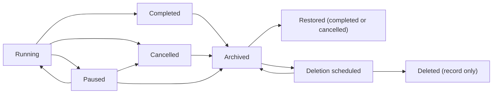

# Archiving and deleting projects

Status: **plan, decided**, 2026-11-07. The Director's answers are under *Decisions*. **All four milestones are built**
(archive, read-only, restore; deletion inside our own stores and of what we created outside them;
the download, the Deleted projects list and the runbook). Left for the Director: the first real
archive, Lambert's Cable and Star LLC.

A project today can run, pause, complete or be cancelled, but there is no way to put it away or to
remove it. This plan adds two steps at the end of a project's life:

- **Archive.** The project stops, leaves the active lists and becomes read-only. Nothing is lost,
  and it can be restored.
- **Delete.** Requested on an archived project, carried out after a grace period, and permanent.
  Everything we hold for the project is removed. A small record that it existed stays, so the
  audit trail still makes sense.

## What exists

| Piece | State | Where |
| --- | --- | --- |
| `archived` status | In the enum | `packages/contracts/src/enums.ts:35-42` |
| `POST /projects/:id/archive` (typed project name) | Route and contract exist | `apps/control-api/src/app.ts:1822-1831`, `contracts/src/commands.ts:232-234` |
| Archive for **demo** projects | Works: appends `project.status archived`, stops the engine | `packages/simulator/src/demo/engine.ts:1750-1761` |
| Archive for **live** projects | **Answers 501.** The Temporal runner has no `archive` | `packages/orchestrator/src/client.ts:91-221` |
| Danger zone button | Shown for every project, says "This cannot be undone" | `apps/web/src/surfaces/settings/DangerZone.tsx:100-112` |
| Read-only after archive | **Not enforced.** Only display text changes | `projector.ts:915`, `voice.ts:642` |
| "Archived" list filter | Exists: completed, cancelled and archived are grouped as Archived | `apps/control-api/src/overview.ts:66`, `DashboardEverything.tsx` |
| Project switcher | Lists every project, archived included | `apps/web/src/overlays/Menus.tsx:33` |
| Cancel a project | Workflow supports it; **no button** | `packages/orchestrator/src/workflows/project.ts:2158-2189` |
| Reset to intake | The nearest thing to delete: terminates the workflow, deletes the event log and the project's blobs | `apps/control-api/src/intake.ts:540-611` |
| Delete a project | **Nothing.** The backend plan intends it ("removes rows, S3 prefixes and vault paths"), unbuilt | `docs/architecture/backend-plan.md:422-424` |
| Who did it | Events record `actor: director`, never the operator's login | `app.ts:1856`, `intake.ts:645` |

## Where a project lives

Deleting a project means finding all of it. The survey found these:

| Store | What | Key |
| --- | --- | --- |
| `lw_events`, `lw_project_heads` | The event log: decisions, cards, artifact versions, settings, credential refs, hosting and build-repo records. Every read model is folded from it in memory, so nothing else needs deleting for the Control Center to forget the project | `project_id` |
| `lw_commands` | Queued commands (done rows swept after a day) | `project_id` |
| `lw_secrets` | Sealed credentials. **The vault has no delete** (`vault.ts:18-19`) | `project_id` |
| `lw_integrations` | `triage-replay:<id>`; saved connections remember `createdFrom.projectId`; Cypher conversations may mention it | key prefix, json |
| `lw_rules`, `lw_rule_history` | Project-scoped rules; global rules whose `source.projectId` is this project; history rows of where a rule was applied | `scope_id`, json |
| `lw_knowledge`, `lw_knowledge_history` | Project-scoped lessons; global lessons learned from it (`source_key = '<id>:phase-N:…'`); where a lesson was used | `scope_id`, `source_key` |
| Blob store | `artifacts/`, `screenshots/`, `assets/`, `diffs/`, `sessions/` under `<projectId>/`. `deleteProject` already pages through and removes them | prefix |
| Temporal | `project:<id>` and its task children. Ends on completion or cancel; `stopProject` terminates | workflow id |
| GitHub | The build repo we created in `GITHUB_BUILD_ORG` | `project.updated {buildRepo}` |
| Vercel | The client's hosting project and deployments we created; sandboxes (`lw-<id>-<task>`, gone after 45 idle minutes) | `project.updated {hosting}` |
| SitecoreAI | Items under the project's owned paths, often on a shared tenant; content published to Edge | `platforms/sitecoreai/pack.ts:66-74` |
| Saved connections | Shared by several projects | `intake.connectionId` |
| Docs in the repo | `docs/runs/*.md` and `docs/projects/*.md` name project ids | text |

## The lifecycle

### Archive

- **Allowed from:** paused, completed or cancelled. A running project has to be paused first; the
  archive button says so until it is.
- **What happens:**
  - If the workflow is still alive (a paused project), the project is cancelled the normal way: open
    tasks cancelled, open cards superseded, children finished.
  - Then `project.status archived` is appended, recording the status it had before.
- **Read-only, enforced on the server:** every command on an archived project answers
  `409 archived`, except restore, request-deletion and the downloads. The UI hides the controls,
  and the switcher and pickers leave it out. It stays under the Dashboard's Archived filter.
- **Restore** brings it back as completed or cancelled, for reading and exporting. It doesn't
  restart work. A client who wants more starts a new project from it with **Remix**
  (`GET /projects/:id/remix`), which already copies the intake.
- **Copy change:** the danger zone stops saying "This cannot be undone" for archive; that line
  belongs to delete.

### Delete

- **Allowed from:** archived only. Two deliberate steps, never one click.
- **Request:** typed project name. The dialog lists what will be removed, offers the downloads
  first (handover pack, documents zip, activity CSV), and asks what to do with each outside
  resource (below).
- **Grace period:** deletion is scheduled for N days later (default 30, `DELETE_GRACE_DAYS`). The
  project shows "Deleting on 7 December" in lists and Settings, with **Cancel deletion**.
- **Purge:** a daily Vercel cron (`/projects/purge-due`, behind `CRON_SECRET`, like the watchdog)
  carries out deletions that are due. Each purge is a recorded job that resumes where it stopped
  if a step fails. The order:

| # | Step | Notes |
| --- | --- | --- |
| 1 | Mark purging | Reads answer 410 from here on |
| 2 | Terminate any Temporal workflow left | `stopProject`; usually already ended at archive |
| 3 | Outside resources, as chosen | Each result recorded |
| 4 | Blobs | `blobs.deleteProject(id)` |
| 5 | Secrets | New `SecretVault.deleteProject`; saved-connection secrets only when no other project uses the connection |
| 6 | Integrations | `triage-replay:<id>`; drop `createdFrom` on connections |
| 7 | Rules and knowledge | Delete project-scoped entries and their history; de-identify global ones (below) |
| 8 | Commands | Rows for the project |
| 9 | The event log | `lw_events`, `lw_project_heads`: last, so a failed purge still shows the project |
| 10 | Tombstone | Final record: id, name, client, dates, who requested and who purged, what each step removed |

**The tombstone** lives in a new `lw_project_tombstones` table and is the only thing left. The
Dashboard can show "Deleted projects" from it. Rules and lessons that came from the project point
at it, so "learned on a deleted project" still reads.

### Delete now

Added after the four milestones, at the Director's request (2026-11-09): some projects should go
at once, not in 30 days: one made by mistake, a test, a demo nobody will open again.

- **Allowed from:** any state but running (pause it first, as for archive). No archive step; an
  archived project already counting down can be deleted now instead.
- **Request:** `POST /projects/:id/delete-now` with the typed name, and `keepRepository` /
  `keepHosting` to keep the build repository or the Vercel project (both deleted by default).
- **Purge:** the same steps as the daily run, started at once by the operator
  (`purgeProject(…, { now: true, keep })`). What the operator chose to keep is written to the
  tombstone as `kept` before anything runs, so a purge cut off part way and finished by the daily
  run keeps it too. The tombstone records the operator as who asked and who purged.
- **UI:** *Delete now* in the danger zone (disabled while running), and beside *Delete in 30 days*
  and *Cancel deletion* on an archived project. The dialog has the keep choices and a download
  link; the typed name is the lock. After it, the Control Center goes back to the Dashboard.

### Deletion readiness

`GET /portfolio/deletion-readiness` asks, read-only, whether a purge would get the outside
resources: GitHub's installation on `GITHUB_BUILD_ORG` must hold Administration: write
(`GithubApp.canDeleteRepos`), and the Vercel token's owner must be an Owner or a Member of the
team (`canDeleteHostingProjects`, from `GET /v2/teams/:id`'s membership). Each answer is `ok`,
`missing` (with what to change), `off` (not connected) or `unknown`; it's kept five minutes. The
Danger zone and *Deleted projects* show it, so a missing permission is fixed before a deletion
rather than found as *Refused* after one.

### Global rules and lessons

Rules and lessons that were promoted out of a project are the product's memory and serve every
client. The plan **keeps them, de-identified**:
- the `source.projectId` points at the tombstone;
- card text quoted in a rule or lesson that names the client is rewritten without the name (a new
  step in the purge);
- history rows keep their counts and lose the project id.

This matches the data-rights clause in the commercial terms. A client on the private-knowledge tier
gets their promoted entries deleted too.

### Outside resources

Deletion cleans up what we created (decision 4). The delete dialog lists each resource so the
operator sees what will go:

| Resource | On purge |
| --- | --- |
| GitHub build repo in our org | Deleted (needs the App's `administration: write`). A repo already transferred to the client is left and recorded as handed over |
| Vercel hosting project in our team | Deleted with its deployments. One already moved to the client's team is left and recorded |
| Saved connection | Removed when no other project uses it |
| SitecoreAI items and Edge content | Left: it is the client's tenant. Demo slots are reset by their own task |

Each result goes in the tombstone, so "what happened to the repo" has an answer.

## Who can do it

- Any operator can archive and restore.
- Requesting a deletion also needs an operator, and **the purge cannot be hurried**. The grace
  period is the safety, not a second approver.
- Archive, restore, request deletion, cancel deletion and purge record the **operator's login** as
  the actor. Today every event says `director`; this plan fixes it for these events, and the same
  change can later cover every command.

## Milestones

| | Work | Done when |
| --- | --- | --- |
| **M1 Archive for real** (built) | `POST /projects/:id/archive` for live projects (cancels a paused project through the workflow, then `archived` with the previous status); a server hook that answers `409 archived` to every change; `POST /projects/:id/restore`; the operator's login as the actor; the danger zone (Archive disabled while running, Restore when archived) and the switcher. No separate Cancel button: archiving a paused project cancels it | `apps/control-api/test/archive.test.ts` and `apps/web/e2e/settings-archive.e2e.ts` |
| **M2 Delete inside our stores** (built) | `POST`/`DELETE /projects/:id/deletion` (archived only, typed name; restore waits until it's cancelled); `project.deletion` events and `deletion` on the project summary; the daily purge `GET /portfolio/purge-due` (Vercel Cron 07:41 UTC, `CRON_SECRET`), resumable step by step; 410 while a purge is under way; `lw_project_tombstones` and `GET /portfolio/deleted`; `SecretVault.deleteProject`, `CommandBus.forget`, `forgetProject` on rules and knowledge; `DELETE_GRACE_DAYS` (default 30); the danger zone's Delete and Cancel deletion | `packages/events/test/forget.test.ts` (Postgres and memory), `apps/control-api/test/archive.test.ts` (purge leaves only the tombstone; a failed purge resumes), `apps/web/e2e/settings-archive.e2e.ts` |
| **M3 Outside resources** (built) | Purge steps `repository` (`GithubApp.deleteBuildRepo`: only in `GITHUB_BUILD_ORG`, a transferred repo is left), `hosting` (`deleteHostingProject`: only in our Vercel team) and `connection` (the saved connection and its secrets, when unused). Anything another project still uses is skipped. GitHub's or Vercel's refusal is recorded and the purge carries on; an outage throws and the next run retries. The delete dialog names the repo and the Vercel project | `packages/connectors/test/delete-repo.test.ts`, `packages/stack/test/delete-hosting.test.ts`, `apps/control-api/test/purge.test.ts` |
| **M4 Exports and housekeeping** (built) | `GET /projects/:id/documents.zip` (every document's latest stored version, the activity CSV and a README; a dependency-free zip writer in `apps/control-api/src/zip.ts`) and download links on an archived project; *Deleted projects* under the Dashboard's Archived filter, from the tombstones, with what happened to the build repository and the hosting project; the runbook in `docs/deploy/vercel.md` (*Archiving and deleting a project*). The first real archive (Lambert's Cable, Star LLC) stays the Director's | `apps/control-api/test/zip.test.ts`, the zip case in `archive.test.ts`, two more cases in `settings-archive.e2e.ts` |

| **Delete now** (built) | `POST /projects/:id/delete-now` (typed name, not while running, `keepRepository`/`keepHosting`); `purgeProject` with `{ now, keep }`, kept steps recorded first; the danger zone's *Delete now* and its dialog; `kept` under *Deleted projects* | `apps/control-api/test/purge.test.ts` (two cases), `apps/control-api/test/archive.test.ts` (two cases), `apps/web/e2e/settings-archive.e2e.ts` |

Later, not in this plan: cleaning a project's owned paths on a shared SitecoreAI tenant;
crypto-shredding with per-client keys (`backend-plan.md`); Temporal history retention, which is a
namespace setting.

## Risks

- **Deleting the wrong project.** Typed name, archive first, a 30-day grace period with Cancel, and
  downloads offered before the request.
- **A half-finished purge.** The job records each step and resumes; the event log goes last, so the
  project stays visible until everything else is gone.
- **Shared things.** Saved connections and tenants are shared. The purge never touches a
  connection another project uses, and never touches a tenant.
- **Deleting something the client now owns.** The purge checks the repo is still in our org and the
  hosting project still in our team before deleting either.
- **Memory loss.** Deleting promoted rules and lessons would make every other project worse. They
  stay, de-identified, unless the client bought private knowledge.

## Decisions

The Director's answers, 2026-11-07:

1. **Grace period:** 30 days.
2. **Who can delete:** any operator.
3. **Promoted rules and lessons:** kept, de-identified.
4. **The build repo and hosting:** cleaned up on deletion. The purge deletes the build repo in our
   GitHub org, the Vercel hosting project, and saved connections no other project uses. Anything
   already transferred to the client is no longer ours to delete; the purge records it as "handed
   over, left".
5. **Archive from running:** not allowed. The project is paused first.
