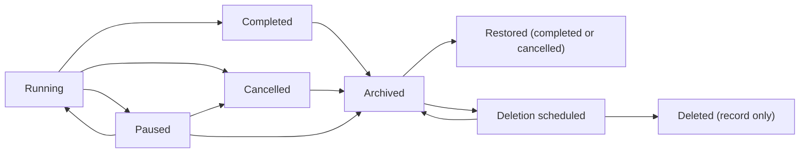

# Archiving and deleting projects

Status: **plan**, 2026-11-07. Nothing here is built yet beyond what *What exists* lists.

A project today can run, pause, complete or be cancelled, but there is no way to put it away or to
remove it. This plan adds two steps at the end of a project's life:

- **Archive.** The project stops, leaves the active lists and becomes read-only. Nothing is lost,
  and it can be restored.
- **Delete.** Requested on an archived project, carried out after a grace period, and permanent.
  Everything we hold for the project is removed. A small record that it existed stays, so the
  audit trail still makes sense.

## What exists

| Piece | State | Where |
| --- | --- | --- |
| `archived` status | In the enum | `packages/contracts/src/enums.ts:35-42` |
| `POST /projects/:id/archive` (typed project name) | Route and contract exist | `apps/control-api/src/app.ts:1822-1831`, `contracts/src/commands.ts:232-234` |
| Archive for **demo** projects | Works: appends `project.status archived`, stops the engine | `packages/simulator/src/demo/engine.ts:1750-1761` |
| Archive for **live** projects | **Answers 501.** The Temporal runner has no `archive` | `packages/orchestrator/src/client.ts:91-221` |
| Danger zone button | Shown for every project, says "This cannot be undone" | `apps/web/src/surfaces/settings/DangerZone.tsx:100-112` |
| Read-only after archive | **Not enforced.** Only display text changes | `projector.ts:915`, `voice.ts:642` |
| "Archived" list filter | Exists: completed, cancelled and archived are grouped as Archived | `apps/control-api/src/overview.ts:66`, `DashboardEverything.tsx` |
| Project switcher | Lists every project, archived included | `apps/web/src/overlays/Menus.tsx:33` |
| Cancel a project | Workflow supports it; **no button** | `packages/orchestrator/src/workflows/project.ts:2158-2189` |
| Reset to intake | The nearest thing to delete: terminates the workflow, deletes the event log and the project's blobs | `apps/control-api/src/intake.ts:540-611` |
| Delete a project | **Nothing.** The backend plan intends it ("removes rows, S3 prefixes and vault paths"), unbuilt | `docs/architecture/backend-plan.md:422-424` |
| Who did it | Events record `actor: director`, never the operator's login | `app.ts:1856`, `intake.ts:645` |

## Where a project lives

Deleting a project means finding all of it. The survey found these:

| Store | What | Key |
| --- | --- | --- |
| `lw_events`, `lw_project_heads` | The event log: decisions, cards, artifact versions, settings, credential refs, hosting and build-repo records. Every read model is folded from it in memory, so nothing else needs deleting for the Control Center to forget the project | `project_id` |
| `lw_commands` | Queued commands (done rows swept after a day) | `project_id` |
| `lw_secrets` | Sealed credentials. **The vault has no delete** (`vault.ts:18-19`) | `project_id` |
| `lw_integrations` | `triage-replay:<id>`; saved connections remember `createdFrom.projectId`; Cypher conversations may mention it | key prefix, json |
| `lw_rules`, `lw_rule_history` | Project-scoped rules; global rules whose `source.projectId` is this project; history rows of where a rule was applied | `scope_id`, json |
| `lw_knowledge`, `lw_knowledge_history` | Project-scoped lessons; global lessons learned from it (`source_key = '<id>:phase-N:…'`); where a lesson was used | `scope_id`, `source_key` |
| Blob store | `artifacts/`, `screenshots/`, `assets/`, `diffs/`, `sessions/` under `<projectId>/`. `deleteProject` already pages through and removes them | prefix |
| Temporal | `project:<id>` and its task children. Ends on completion or cancel; `stopProject` terminates | workflow id |
| GitHub | The build repo we created in `GITHUB_BUILD_ORG` | `project.updated {buildRepo}` |
| Vercel | The client's hosting project and deployments we created; sandboxes (`lw-<id>-<task>`, gone after 45 idle minutes) | `project.updated {hosting}` |
| SitecoreAI | Items under the project's owned paths, often on a shared tenant; content published to Edge | `platforms/sitecoreai/pack.ts:66-74` |
| Saved connections | Shared by several projects | `intake.connectionId` |
| Docs in the repo | `docs/runs/*.md` and `docs/projects/*.md` name project ids | text |

## The lifecycle

### Archive

- **Allowed from:** paused, completed or cancelled. A running project is paused first; the dialog
  offers to do it.
- **What happens:**
  - If the workflow is still alive (a paused project), the project is cancelled the normal way: open
    tasks cancelled, open cards superseded, children finished.
  - Then `project.status archived` is appended, recording the status it had before.
- **Read-only, enforced on the server:** every command on an archived project answers
  `409 archived`, except restore, request-deletion and the downloads. The UI hides the controls,
  and the switcher and pickers leave it out. It stays under the Dashboard's Archived filter.
- **Restore** brings it back as completed or cancelled, for reading and exporting. It doesn't
  restart work. A client who wants more starts a new project from it with **Remix**
  (`GET /projects/:id/remix`), which already copies the intake.
- **Copy change:** the danger zone stops saying "This cannot be undone" for archive; that line
  belongs to delete.

### Delete

- **Allowed from:** archived only. Two deliberate steps, never one click.
- **Request:** typed project name. The dialog lists what will be removed, offers the downloads
  first (handover pack, documents zip, activity CSV), and asks what to do with each outside
  resource (below).
- **Grace period:** deletion is scheduled for N days later (default 30, `DELETE_GRACE_DAYS`). The
  project shows "Deleting on 7 December" in lists and Settings, with **Cancel deletion**.
- **Purge:** a daily Vercel cron (`/projects/purge-due`, behind `CRON_SECRET`, like the watchdog)
  carries out deletions that are due. Each purge is a recorded job that resumes where it stopped
  if a step fails. The order:

| # | Step | Notes |
| --- | --- | --- |
| 1 | Mark purging | Reads answer 410 from here on |
| 2 | Terminate any Temporal workflow left | `stopProject`; usually already ended at archive |
| 3 | Outside resources, as chosen | Each result recorded |
| 4 | Blobs | `blobs.deleteProject(id)` |
| 5 | Secrets | New `SecretVault.deleteProject`; saved-connection secrets only when no other project uses the connection |
| 6 | Integrations | `triage-replay:<id>`; drop `createdFrom` on connections |
| 7 | Rules and knowledge | Delete project-scoped entries and their history; de-identify global ones (below) |
| 8 | Commands | Rows for the project |
| 9 | The event log | `lw_events`, `lw_project_heads`: last, so a failed purge still shows the project |
| 10 | Tombstone | Final record: id, name, client, dates, who requested and who purged, what each step removed |

**The tombstone** lives in a new `lw_project_tombstones` table and is the only thing left. The
Dashboard can show "Deleted projects" from it. Rules and lessons that came from the project point
at it, so "learned on a deleted project" still reads.

### Global rules and lessons

Rules and lessons that were promoted out of a project are the product's memory and serve every
client. The plan **keeps them, de-identified**:
- the `source.projectId` points at the tombstone;
- card text quoted in a rule or lesson that names the client is rewritten without the name (a new
  step in the purge);
- history rows keep their counts and lose the project id.

This matches the data-rights clause in the commercial terms. A client on the private-knowledge tier
gets their promoted entries deleted too.

### Outside resources

We don't own everything we created, and some of it is the client's after handover. Nothing outside
our own stores is touched unless the operator chooses it in the delete dialog:

| Resource | Choices | Default |
| --- | --- | --- |
| GitHub build repo | Leave; archive on GitHub; delete (needs the App's `administration: write`) | Leave if handed over, otherwise archive |
| Vercel hosting project | Leave; delete | Leave if handed over, otherwise delete |
| Saved connection | Remove when no other project uses it | Remove if unused |
| SitecoreAI items and Edge content | Not in this plan: it is the client's tenant. Demo slots are reset by their own task | Leave |

Each choice and its result goes in the tombstone, so "what happened to the repo" has an answer.

## Who can do it

- Any operator can archive and restore.
- Requesting a deletion also needs an operator, and **the purge cannot be hurried**. The grace
  period is the safety, not a second approver.
- Archive, restore, request deletion, cancel deletion and purge record the **operator's login** as
  the actor. Today every event says `director`; this plan fixes it for these events, and the same
  change can later cover every command.

## Milestones

| | Work | Done when |
| --- | --- | --- |
| **M1 Archive for real** | `archive` in the Temporal runner (cancel if alive, then `archived` with the previous status); server-side read-only; restore; the operator's login on these events; copy and menu fixes; a Cancel project button in the danger zone | A live project archives, every command answers 409, it restores as completed or cancelled. Tests in `orchestrator`, `control-api`, and an e2e on the danger zone |
| **M2 Delete inside our stores** | Request and cancel deletion; grace period; the purge job and cron; `SecretVault.deleteProject`; tombstones; rules and knowledge de-identified | A purged project leaves only its tombstone: no rows, blobs or secrets under its id (checked by a test against Postgres and a local blob store), and a purge interrupted at any step finishes on the next run |
| **M3 Outside resources** | The delete dialog's choices; GitHub archive and delete; Vercel project delete; unused saved connections | Each choice runs, and its result is recorded in the tombstone |
| **M4 Exports and housekeeping** | Documents zip download; "Deleted projects" list from tombstones; runbook in `docs/deploy/vercel.md`; the open Director decision on Lambert's Cable and Star LLC as the first real archive | An operator can download everything, then delete, without help |

Later, not in this plan: cleaning a project's owned paths on a shared SitecoreAI tenant;
crypto-shredding with per-client keys (`backend-plan.md`); Temporal history retention, which is a
namespace setting.

## Risks

- **Deleting the wrong project.** Typed name, archive first, a 30-day grace period with Cancel, and
  downloads offered before the request.
- **A half-finished purge.** The job records each step and resumes; the event log goes last, so the
  project stays visible until everything else is gone.
- **Shared things.** Saved connections and tenants are shared. The purge never touches a
  connection another project uses, and never touches a tenant.
- **Memory loss.** Deleting promoted rules and lessons would make every other project worse. They
  stay, de-identified, unless the client bought private knowledge.

## Open questions for the Director

1. **Grace period:** is 30 days right?
2. **Who can delete:** any operator, or a named list?
3. **Promoted rules and lessons:** keep them de-identified (this plan), or delete them with the project?
4. **The build repo and hosting:** default to leaving them, or to cleaning up what wasn't handed over?
5. **Archive from running:** pause first (this plan), or allow archiving a running project directly?
