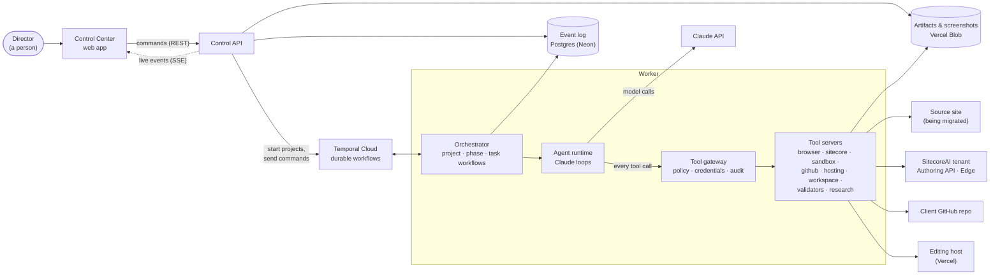
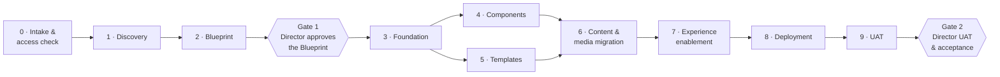
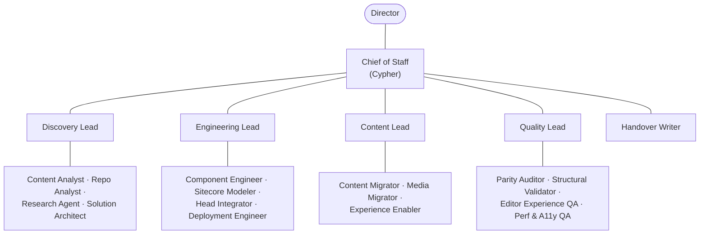
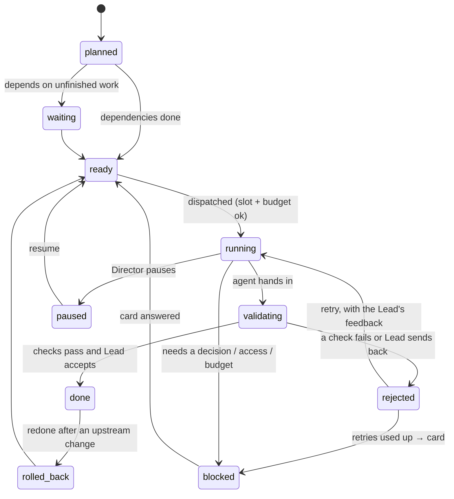
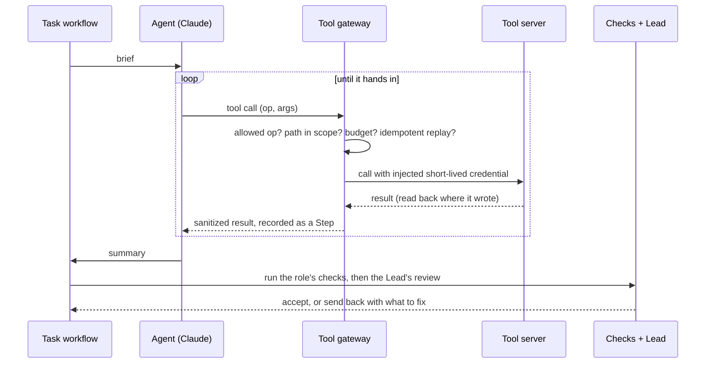
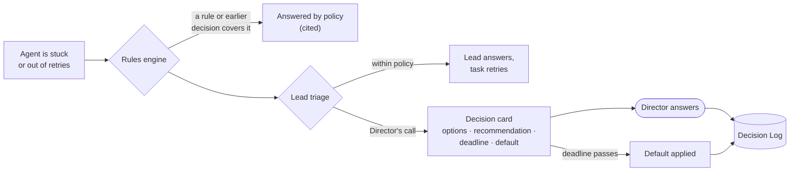
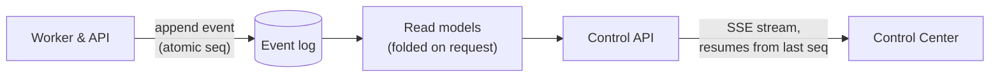

# How Launchworks works

A guide to what happens under the hood, for someone who wants to understand the whole system. It
describes what is built and running today. The design documents in `docs/architecture/` go deeper
on each part; the map at the end says which one to read for what.

---

## 1. What it is, in one paragraph

Launchworks is Icreon's agentic implementation studio. A person (the **Director**) starts a
project, for example "rebuild cabotcorp.com on SitecoreAI", and a team of Claude agents does the
work: crawls the source site, designs the content model, writes and registers components, builds
templates, migrates hundreds of pages and media, deploys, and hands over. The Director steers
through the **Control Center** (the web app, whose assistant voice is **Cypher**): approves the two
gates, answers decision cards, sends notes and directives, sets budgets, pauses and resumes. Every
action an agent takes is a recorded, policy-checked tool call, and nothing counts as done until
automated checks and a Lead agent's review accept it.

---

## 2. The big picture

Read it left to right: the Director acts in the Control Center; the API turns each action into a
command and every change into an event; Temporal runs each project as a durable workflow in the
worker; workflows dispatch agents; agents think with Claude and act only through the tool gateway;
tool servers touch the outside world.

---

## 3. Three layers: method, platform, playbook

| Layer | What it holds | Where |
| --- | --- | --- |
| **The method** | How every team works, whatever the job: Director, Chief of Staff, Leads, specialists; gates and decision cards; budgets and escalation; evidence, read-back and acceptance | `packages/` (orchestrator, gateway, runtime, Control Center) |
| **Platform pack** | What is true of a platform: intake fields, credential types and how each is verified, which credential each tool server carries, what a project may write (scopes), platform knowledge | `platforms/sitecoreai/`, `platforms/optimizely/` |
| **Playbook** | The job to be done: the charter (mission and outcomes), intake, phases and gates, roles, prompts, the task plan, the Definition of Done, playbook knowledge | `playbooks/<id>/` |

Playbooks today: `sitecoreai-migration` (Build a SitecoreAI website, v0.21.0),
`sitecoreai-homepage-demo`, `sitecoreai-customer-portal`, `optimizely-saas-migration`.

**A project pins its playbook version when it is created.** Improvements ship to new projects;
a running project keeps its team, prompts and checks (older versions are kept under
`playbooks/.versions/`). Cabot, for example, runs on `sitecoreai-migration` 0.20.0.

---

## 4. A project's life

| Phase | What the team does | It's done when |
| --- | --- | --- |
| 0 Intake | Verifies every credential against its real endpoint (GitHub, Authoring API, Deploy API, Edge, hosting) | Every credential works; tenant facts recorded |
| 1 Discovery | Crawls the source site, inventories components, pages and assets, reads the repo | Inventories complete; every sitemap URL crawled or excluded |
| 2 Blueprint | The Solution Architect maps every source component to a rendering and every page to a template | **Gate 1:** the Director approves |
| 3 Foundation | Site, languages, folders, design tokens, hosting project, editing host | An empty page renders on the editing host |
| 4 Components | Port each component to the Content SDK, register it in Sitecore, integrate and deploy. A pilot slice goes end to end first | Every Blueprint component works in Page builder |
| 5 Templates | Page templates, standard values, insert options, page designs, header and footer | Every template renders with its partials |
| 6 Migration | Pages and media, one task per page | Content parity ≥ 98%, media with alt text, no broken links |
| 7 Experience | Redirects, SEO, sitemap, robots, 404/500, dictionary | All in place |
| 8 Deployment | Three verified releases, scoped publishing | Every route resolves on Experience Edge |
| 9 UAT | Runbook, component catalog, decision and known-gaps registers, UAT checklist | **Gate 2:** the Director accepts |

**The plan grows with the project.** The plan compiler (`packages/plan`) turns the playbook into a
skeleton task graph on day one. When the Blueprint is approved it expands to one task per component
(port, register, integrate), template and page. Cabot's plan is about 440 tasks.

---

## 5. The team

- **Director**: the person in charge. Owns the gates, the budget, scope and any decision the team
  can't make by policy.
- **Chief of Staff**: talks to the Director, reads messages and turns them into notes or plan
  changes, writes the decision cards, keeps the Decision Log. It has no tools that touch the client's
  systems.
- **Leads** (four): review every finished task in their workstream, answer specialists' questions
  by policy where they can, and send the rest up as cards.
- **Specialists** (sixteen): do the work. Each role is one YAML file (`roles/*.yaml`) naming its
  model, prompt, tools, the exact operations it may call, the paths it may write, its checks and its
  budget. A Content Migrator *cannot* create a template: the gateway refuses it, whatever the prompt says.

Specialists start every task fresh (no carried memory); what they need arrives in the brief.

---

## 6. How one task runs

### 6.1 The brief

When a task starts, the agent runtime (`packages/agent-runtime`) builds its prompt in a fixed,
cache-friendly order, so forty tasks of the same role reuse one cached prefix:

1. The **role prompt** and the playbook **charter**.
2. **Platform and playbook knowledge**, and **lessons** from the knowledge store that apply to this
   role, platform and operation (`packages/stack/src/knowledge.ts`).
3. The task's slice of the approved **Blueprint** (a page's URL and template, a component's fields).
4. **Facts** other tasks produced that this one needs: item IDs, paths, renderings
   (`packages/stack/src/facts.ts`).
5. The **Director's notes** and, on a retry, the **Lead's feedback** and the Director's rerun
   instructions.

### 6.2 The loop

- **Each model call and each tool call is its own durable Step.** If the worker restarts, the task
  resumes at the next unfinished Step; a replayed Step returns its recorded result instead of acting
  twice.
- **Writes read back.** Authoring writes (`item.update`, `item.create`) read the item back and report
  what Sitecore actually holds; component writes run a build; deploys are confirmed live.
- **Output limits are handled.** A reply cut off at the output limit is discarded (nothing in it
  ran) and the agent is told to write less.

### 6.3 Acceptance: checks, then the Lead

A task counts as done only after its **automated checks** and its **Lead's review**
(`packages/stack/src/review.ts`). A check that doesn't exist yet reports *pending*, never pass. The
Lead judges the result against the Steps the specialist actually took, not against its summary.

| Check (examples) | What it proves |
| --- | --- |
| `build.green` | The editing host builds and type-checks after the last change, and it's committed |
| `component-map.registered` | The Content SDK component map was regenerated |
| `editing-host.deployed` | Branches integrated, build green, deployment live on the editing host |
| `structural.layouts` | Every page's components sit on a layout Sitecore can read |
| `head.pages-render` | Each page renders on the editing host |
| `parity.render` | The new page carries ≥ 90% of the source page's words and its headings |
| `parity.visual` | Screenshots of source and new page compared by a vision model, section by section |

When something fails, the Lead's model sorts it: is it the page's own work, or a component the page
depends on? Component faults send the page to wait on a fix to that component, rather than retrying
the page.

---

## 7. The tool gateway and tool servers

Every tool call from every agent goes through one policy enforcement point
(`packages/tool-gateway`), in this order:

1. **Authorize**: is this role allowed this operation, and is the target path inside its scope?
2. **Rate-limit** per target system.
3. **Idempotency**: a replayed Step returns the recorded result.
4. **Credentials**: a short-lived token is injected for this call. Agents never see secrets.
5. **Execute** on the tool server.
6. **Record** the Step (operation, result code, duration, tokens) on the project's event log.
7. **Sanitize**: redact secrets, and mark fetched web and repo content as untrusted data.

| Tool server | What it does |
| --- | --- |
| `browser` | Crawls (any size), snapshots, screenshots, page markup and styles, layout data, asset fetch. All Chromium traffic goes through an egress proxy that refuses private addresses |
| `sitecore` | Authoring API: items, templates, renderings, media, publishing; Experience Edge reads; Deploy API |
| `sandbox` | A working copy of the client repo: file reads and edits, builds, the Content SDK CLI |
| `github` | Clone, branch, commit, read; writes only to `launchworks/*` branches |
| `hosting` | Vercel projects, env vars, deployments, logs |
| `workspace` | Versioned project documents, the Blueprint, the Decision Log, facts |
| `validators` | axe-core, Lighthouse, screenshot pixel diff |
| `research` | Read-only web search and fetch, for platform docs |

---

## 8. Escalations, cards and the Director

- **When to escalate is decided by code, not by a model**: rejected too many times, retries
  exhausted, an access failure, a budget threshold, or an agent's explicit decision flag.
- **Never re-ask.** A question is checked against the Decision Log first; an earlier answer settles
  it, with a citation.
- **Cards default at their deadline** where a safe default exists (a gate never does).
- **Director controls**: approve or send back a gate; answer, defer or hold a card; send a note to
  the whole team; rerun a task with instructions; pause, resume or cancel at any level (project,
  phase, task, agent); change budgets (tokens, dollars, hours). Reversible actions have a 10-second
  Undo, held on the server.

---

## 9. Memory and learning

Nothing an agent "remembers" lives in a model. The project's memory is data:

| Store | What it is | Who writes it |
| --- | --- | --- |
| **Event log** | Every task state change, Step, review, card and message, in order | The system |
| **Facts** | What tasks made: item IDs, paths, renderings, URLs | Tasks, as they write |
| **Blueprint** | The approved mapping of source to Sitecore, versioned | Solution Architect, then Director edits |
| **Decision Log** | Every Director decision and card answer, with its scope | Director, Chief of Staff |
| **Knowledge store** | Lessons and rules, scoped by platform, playbook, role and operation | Proposed by the system, **approved by the Director** |

**How the team gets better:**

- **Rules from cards**: answered cards with the same cause and answer, seen twice or more, are
  drafted into a proposed rule (`learning.ts`). Approved rules answer the next such question
  automatically.
- **Phase retrospectives**: when a phase ends, Cypher groups what it cost by cause into proposed
  lessons, procedures and gaps (`retrospective.ts`).
- **Nothing applies until the Director approves it.** Client data never crosses projects; what
  crosses is approved, client-free lessons and new playbook versions.

---

## 10. Data, events and the live view

- **Event-sourced.** The event log (Postgres on Neon) is the source of truth. Read models
  (mission control, plan, activity) are folds of it, caught up on each request.
- **Live updates** stream to the browser over Server-Sent Events with per-project sequence numbers,
  so a reconnect replays exactly what was missed.
- **Large things** (artifacts, screenshots, crawl snapshots, uploaded assets) live in a private
  Vercel Blob store.
- **Temporal Cloud** holds workflow state: timers (card deadlines, the 30-second directive stop
  window, Undo), retries, and resumption after a crash.

---

## 11. Where it runs

| Unit | Runs as | What it does |
| --- | --- | --- |
| `web` | Static build on Vercel's CDN | The Control Center |
| `api` | Vercel Function (container image) | Snapshots, commands, event streams, intake, sign-in |
| `worker` | Vercel Daemon (long-lived container) | Temporal workflows and activities, agents, tool servers, Chromium |
| Watchdog | Vercel Cron on the API | Tells the Director if the worker goes silent (it heartbeats every 30 s) |

External: Neon Postgres, Vercel Blob, Temporal Cloud, the Claude API, GitHub (OAuth sign-in and the
client repos), and each client's SitecoreAI tenant. Production: https://launchworks-one.vercel.app.

Models: Opus for the Chief of Staff, Architect and Leads; Sonnet for specialists; Haiku for sweeps
and classification. All per-role configurable.

---

## 12. Security in one list

- Agents never hold credentials; the gateway injects short-lived ones per call.
- Each role is limited to named operations and path scopes, enforced in code.
- Destructive work records how to undo it first; rollbacks run in reverse dependency order.
- Content from the source site, repos and the web is wrapped as untrusted data.
- Browser traffic goes through an egress proxy that blocks private and internal addresses.
- Sign-in: GitHub for Icreon operators (allow-list, org 2FA), WorkOS for invited people; every
  request acts inside one organization.
- Client data stays in its project; learning moves only as approved, client-free lessons.

---

## 13. Glossary

| Term | Meaning |
| --- | --- |
| Blueprint | The approved plan of record: source components → renderings, pages → templates, field contracts |
| Card | A decision the Director is asked to make, with options, a recommendation and a deadline |
| Director note | A message from the Director every agent sees from its next task |
| Editing host | The client's Next.js (Content SDK) app that Page builder renders, deployed on Vercel |
| Fact | A recorded output of a task (an item ID, a path) that later tasks look up |
| Gate | A phase boundary only the Director can pass (Blueprint, UAT) |
| Lead review | A Lead agent's judgment of a finished task, against the Steps it actually took |
| Parity | How closely the new page matches the source, in text (`render`) and look (`visual`) |
| Playbook | A versioned definition of a kind of job: phases, roles, prompts, plan, checks |
| Platform pack | What's true of a platform: credentials, scopes, knowledge |
| Step | One recorded model call or tool call |
| Variant | One of a component's named layouts (e.g. Image and Text `Wide`), chosen per page |

---

## 14. Where to read more

| To understand… | Read |
| --- | --- |
| The original architecture and decisions | `docs/architecture/backend-plan.md` |
| Playbooks and platform packs | `docs/architecture/playbooks.md`, `entities.md` |
| Organizations, roles, licensing, sign-in | `docs/architecture/multi-tenancy.md` |
| How agents learn and stay stable | `docs/architecture/agent-intelligence-plan.md` |
| Crawling large sites | `docs/architecture/large-site-crawl.md` |
| The Control Center's API | `docs/architecture/admin-console-api.md`, `control-center-spec.md` |
| Security review | `docs/architecture/security-pass.md` |
| Deploying | `docs/deploy/vercel.md`, `docs/deploy/workos.md` |
| Running it locally | `README.md` |

Code entry points: `packages/stack/src/compose.ts` (how everything is wired),
`packages/orchestrator` (workflows), `packages/agent-runtime/src/runtime.ts` (the agent loop),
`packages/tool-gateway` (policy), `packages/stack/src/review.ts` (acceptance),
`platforms/sitecoreai/checks.ts` (the SitecoreAI checks).
