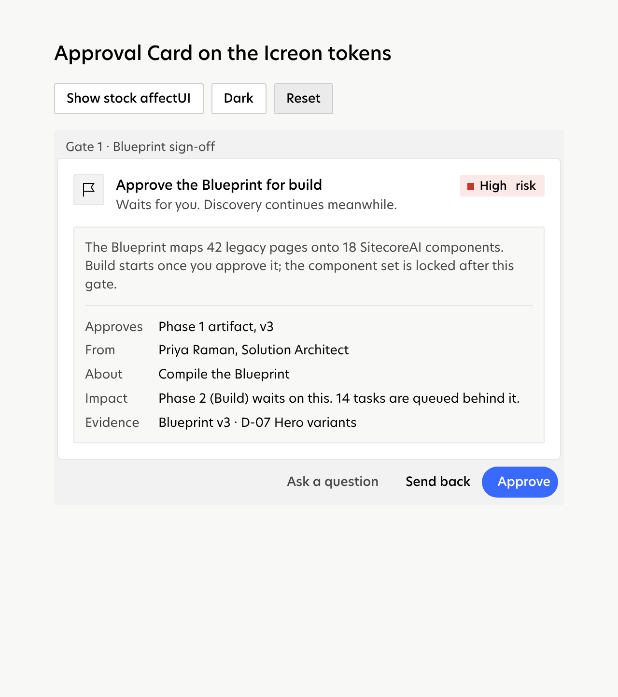
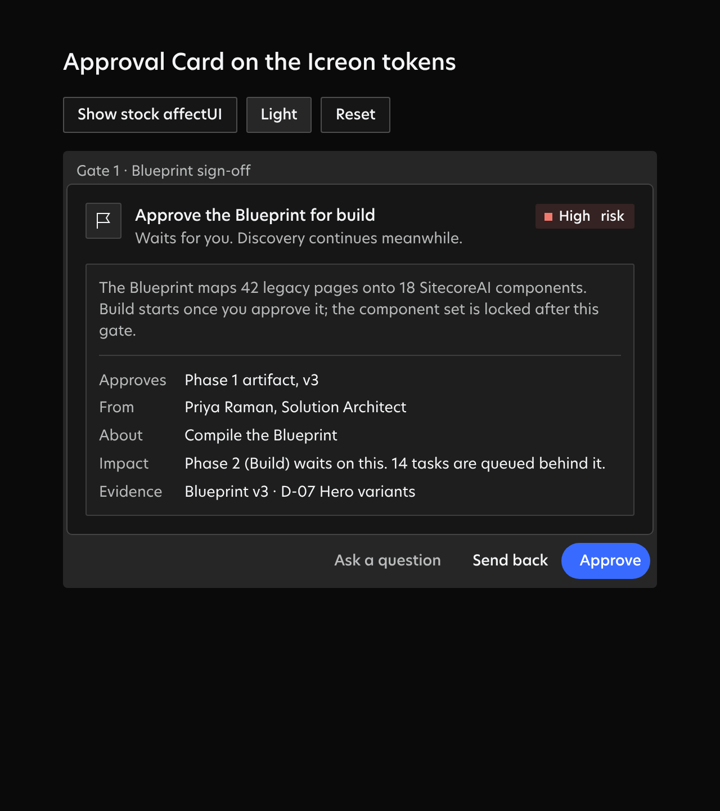
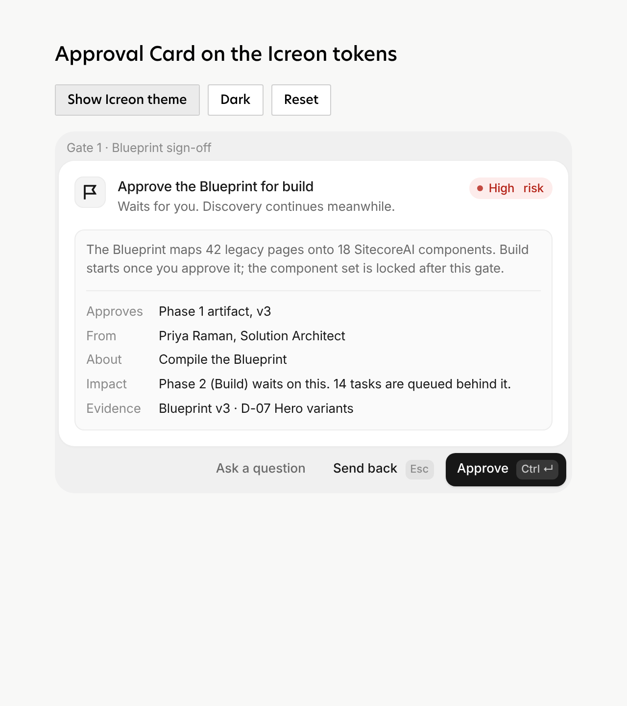

# affectUI for the Control Center: evaluation and plan

Research and planning only: no app component has been replaced. A themed proof of concept is in
[`apps/web/scratch/affectui-poc`](../../apps/web/scratch/affectui-poc/README.md), outside the app's build.

## Summary

- **The fit is real, but narrow.** affectUI is strong exactly where the Control Center is
  domain-specific and thin today: agent approvals, decisions, run traces, agent trees and toasts.
  It has **no basic primitives**: no Dialog, Popover, Tooltip, Dropdown or Context Menu, Input, Select,
  Checkbox, generic Table or Markdown renderer. Its own guide positions it as an add-on to shadcn/ui.
  So it can't replace our basic components. It can replace or upgrade about a dozen of our
  agent-facing pieces and add several capabilities we don't have.
- **Theming works, and stays Icreon.** Every item reads its colors and easing from
  `--ui-<prefix>-*` variables. Pointing those at our `--web-*` tokens gives us light, dark and
  "follow the system" from our single token set. Radius, font and weight are literals, so each item
  also needs a dozen lines of class overrides. The Approval Card proof of concept is
  indistinguishable from our own UI in both themes (screenshots below).
- **Blocker before any Pro adoption: this repository is public.** The license allows Pro source in
  *private* repositories and forbids publishing it, "for example in a public repository". The proof
  of concept therefore fetches the Pro file into a git-ignored folder. We need a private home for Pro
  code, and a Team license (10 seats) if more than one developer touches it.
- **Cost:** 1.3–19 KB gzipped per item (most are 6–11 KB) against our 143 KB main bundle. A sensible
  first wave adds about 30–45 KB gzipped unless we lazy-load by surface.
- **Recommendation:** adopt selectively, theme through one bridge stylesheet, and start with the
  free items plus Approval Card and Toaster (Phase 1). Leave our shell, buttons, forms, dialogs,
  tables and docs as they are.

## How this was checked

- The affectUI MCP server in `.mcp.json` works with `AFFECTUI_API_KEY`. `list_components` returned all
  126 items (40 free, 86 Pro), and `get_source` returned the full Pro source of `approval-card`. The
  shadcn registry (`/r/<slug>.json`) answers 200 with the key and 401 without it.
- We read the docs for 56 relevant items plus the theming, installation, accessibility, license,
  pricing and terms pages (the site is a single-page app, so its text was taken from its bundles and
  `llms-full.txt`). We inspected source for 19 items and built 18 of them to measure size and global
  listeners.
- We read every component and surface in `apps/web/src` and both stylesheets.

## 1. Our UI today

The Control Center is about 8,000 lines of TSX and 5,600 lines of CSS. There is no component library underneath. Most "components" are CSS classes in `prototype.css` (the original HTML prototype's stylesheet) plus `app.css` (additions for real data), applied by hand in each surface. Only a few are React components shared across files.

### 1a. Shared React components

| Component | File | What it does | Used in |
|---|---|---|---|
| `Card` (+ `useCardActions`) | `parts/Card.tsx` | Escalation card in three modes (`compact`, `queue`, `full`) plus resolved and deferred rows. Covers multiple-choice decisions (A–D keys, recommended option, optional note), gates (Approve / Send back / Ask), a default-action countdown, evidence chips, grouped cards and Undo. | Inbox (full). `useCardActions` also drives the global keys in `App.tsx` |
| `Chip` | `parts/bits.tsx` | Status marker for agent and task states: a square colored marker with the text in ink | Team, Plan, Settings, Inspector, Dock, Workbench |
| `Who` | `parts/bits.tsx` | Prose with role names turned into people (persona name, role on hover) | Card, Team, Inspector, Dock |
| `AgentCell` | `parts/bits.tsx` | Two-line agent name/role cell for tables | Activity, Plan (List) |
| `useJump` | `parts/bits.tsx` | Routes a `LinkTarget` (artifact, task, agent, PR…) to the right surface | Card, Dock |
| `MarkdownDoc` | `parts/Doc.tsx` | Sanitized GFM with callouts, lazily loaded mermaid, `blob://` images, `artifact://` links and a TOC | Workbench |
| `DataDoc` | `parts/DataDoc.tsx` | JSON artifacts as Page Inventory, Repo Inventory or a generic outline, with a raw toggle | Workbench |
| `Scrim` | `overlays/Dialogs.tsx` | Dimmed overlay layer that closes on an outside click | All overlays |
| `TypedConfirm` | `overlays/Dialogs.tsx` | Confirm dialog; the danger variant asks you to type a name | Card (final gates), Settings (danger zone), Inspector |
| `TextForm` | `overlays/Dialogs.tsx` | One required textarea in a dialog (⌘↵ submits) | Plan (re-run group), Inspector |
| `Palette` | `overlays/Palette.tsx` | ⌘K command palette: surfaces, agents, verbs (pause, approve, theme), projects and artifacts. Substring filter, arrow keys | Shell (search button, ⌘K) |
| `ProjectMenu`, `DemoMenu`, `MoreSheet` | `overlays/Menus.tsx` | Project switcher with health dots and badges, a demo scenario menu, and the mobile "More" bottom sheet | Shell, MobileNav |
| `NewProject` | `overlays/NewProject.tsx` | Multi-step wizard driven by the playbook: playbook → project → source → credential steps (with live checks) → brief → review | Sidebar, Palette, ProjectMenu |
| `Sidebar`, `Strip`, `MobileNav`, `Toasts` | `Shell.tsx` | App frame: brand, project switcher, nav with counts, theme toggle, collapse; the top status strip (phase, health, waiting, clock, budget, connection, ⌘K); the phone tab bar; the toast stack | `App.tsx` |
| `Dock` (+ `Conversation`, `Message`, `Directive`, `Composer`) | `dock/Dock.tsx` | Cypher, the Chief of Staff chat: presence, a "needs you" strip, day separators, grouped messages, rich embeds (status, needs-you, up next, briefs), directives with acknowledgement, quick prompts and a composer | `App.tsx` (right column) |
| `Inspector` (`AgentPanel`, `TaskPanel`) | `Inspector.tsx` | Right-hand drawer for an agent (role, model, tokens, now/next, recent tool calls, pause/resume) or a task (contract, window, dependencies, re-run/complete/cancel) | `App.tsx` when something is inspected |
| `Icon`, `Sprite`, `Lockup` | `lib/icons.tsx` | IBM Carbon icon sprite from the Icreon design system, used through `<use href="#ic-…">`, plus the Icreon lockup | Everywhere |

### 1b. Surfaces (one per nav item)

| Surface | File | What's on it | Patterns used |
|---|---|---|---|
| Mission Control | `surfaces/Mission.tsx` | "Since you were away" line, Ready to start, Waiting on you list, stat cards with bars, phase stepper, team-now rows, latest events | panel, statcard, stepper, kv, dot, event list, link-btn |
| Needs you (Inbox) | `surfaces/Inbox.tsx` | List and detail: open/deferred/just-decided groups, J/K to move, 1–4 to choose, Answer in bulk dialog, CSV export | list rows, `Card`, dialog, select, textarea |
| Team | `surfaces/Team.tsx` | Org chart by workstream: agent cards with state chip, now/next and a step bar; filter segment | seg, acard, chip, bar |
| Plan | `surfaces/Plan.tsx` | Three views: Today (per-agent lanes on an hour axis with a now line and zoom), Engagement (phases × days Gantt with zoom), List (filterable activity table with group re-run). Phone variants | seg tabs, zoom control, Gantt bars, legend, table, filters, details |
| Workbench | `surfaces/Workbench.tsx` | Wiki: page rail with search, breadcrumbs, a doc, an "on this page" TOC. Viewers for Blueprint (rows with status/changed), Decision Log, artifacts (stats, scores, tables, blocks) and Pull Requests (files ±) | rail, TOC, tables, tags, `MarkdownDoc`, `DataDoc` |
| Site preview | `surfaces/Preview.tsx` | Page list with migrated state, breakpoint segment, side-by-side legacy/new panes | seg, pane frames |
| Activity | `surfaces/Activity.tsx` | Tool-call log table (time, agent, tool, operation, result, duration, tokens): severity filters, agent select, live tail switch, "N new events" pill, load older, CSV | filters, select, toggle, table, pill |
| Settings | `surfaces/Settings.tsx` | Intake values, credentials table with verify/re-check, GitHub App, budgets (3 meters plus a form), gates (switches), escalation policy, playbook, brief, build repo, source site, conventions, capability gaps, danger zone | panel, table, toggle, bar, forms, `TypedConfirm` |
| GitHub App | `surfaces/GithubApp.tsx` | Create/install a GitHub App from a manifest, with permissions list | panel, form field, hint |

### 1c. CSS-only primitives (the de facto design system)

| Primitive | Classes | Notes |
|---|---|---|
| Buttons | `.btn`, `.btn.primary` (blue pill), `.btn.sm`, `.btn.danger`, `.iconbtn`, `.link-btn`, `.btn-row` | 89 uses across 15 files. State layer via `::after` at `--state-hover` / `--state-pressed` |
| Status | `.chip.<state>`, `.type.<escalation-type>`, `.dot.good/warn/bad/idle`, `.badge`, `.count` | Color is never the only signal: a square marker plus the word |
| Containers | `.panel`, `.panel-head`, `.page-head`, `.statcard`, `.kv`, `.quiet-line`, `.embed` | `.panel` (28 uses) is the card surface: 4 px radius, hairline border, no shadow |
| Inputs | `.input`, `.select`, `textarea.notes`, `.toggle[role=switch]`, `.seg`/`.filters` (aria-pressed button groups), `.wiz-field`/`.wiz-hint` | No combobox, date picker or validation component |
| Overlays | `.scrim`, `.dialog`, `.menu`, `.sheet`, `.palette`, `.toasts`/`.toast` | Elevation `--elev-5`, `rise` animation |
| Progress | `.bar > i`, `.phase-bar`, `.stepper .step`, `.abar` | Plain width percentages |
| Data | `table` in `.act`, `.pl-list`, Settings tables; `.num`, `.mono`, `.tnum` | No sorting, selection or virtualization |

### 1d. Behaviors worth keeping whatever we adopt

- **Keyboard:** ⌘K palette, ⌘/ composer, `g`+letter chords, `?` help, J/K in Needs you, 1–4 to choose an option, D to defer, A to approve a gate, Esc to leave presentation mode or close overlays (`App.tsx` `useKeys`).
- **Domain rules in components:** grouped escalations answer all siblings; gates never default and can't be bulk-answered; final gates need a typed confirmation; undo windows; `reversible`.
- **Copy and tone:** plain sentences ("Waits for you. No default action.") and people's names via `Who`.

### 1e. Gaps we found along the way

- Dialogs have `role="dialog"` but no `aria-modal`, no focus trap and no focus return. `Scrim` closes on an outside click, while Esc is handled globally.
- The palette's input isn't a `combobox` and has no `aria-activedescendant`, so screen readers don't hear the selected row. Results aren't grouped and matching is substring-only.
- Toasts live in one `aria-live` region, with no timing control, no stacking and no promise state.
- Tables can't sort, select or copy. The Activity log renders up to 150 rows and then pages.
- There are no skeleton or loading states: surfaces show a "Loading…" quiet line.

## 2. Our design system, as the CSS defines it

All tokens live in `:root` at the top of `apps/web/src/styles/prototype.css`, copied from the
Icreon Design System (`brand-core/colors_and_type.css`, `web-foundations.css`). `app.css` adds no new
tokens. Components only ever reference the semantic `--web-*` layer, never the brand values directly.

### Color

| Layer | Token | Light | Dark |
|---|---|---|---|
| Brand | `--icreon-blue` / `-deep` / `-soft` / `-tint` | `#386aff` / `#2752e0` / `#7e9dff` / `#e7ecff` | same |
| Neutrals | `--neutral-950 … -50` | `#0a0a0a` `#141414` `#2a2a2a` `#474747` `#7a7a7a` `#a3a3a3` `#cfcfcf` `#e6e6e6` `#f2f2f2` `#f8f8f7` | same |
| Page | `--web-bg` | neutral-50 | `#0a0a0a` |
| Surfaces | `--web-surface`, `-surface-2`, `-surface-3` | white, neutral-50, neutral-100 | `#161616`, `#1e1e1e`, `#262626` |
| Text | `--web-fg`, `-fg-2`, `-fg-3` | black, neutral-700, neutral-500 | `#f4f5f7` at 100 / 72 / 50 % |
| Inverse | `--web-inverse`, `--web-fg-on-inverse` | black on white | white on black |
| Accent | `--web-accent`, `-accent-hover`, `-accent-text`, `--web-fg-on-accent` | blue, blue-deep, blue-deep (small text clears AA), white | blue, `#5c84ff`, `#7e9dff`, white |
| Lines | `--web-border`, `-border-strong` | neutral-200, neutral-300 | white at 14 % / 24 % |
| Status | `--success` `--warning` `--danger` `--info` + `-bg` | `#1e8e5a` `#b26a00` `#c8372d` blue on tints | `#4ecb8a` `#e0a042` `#f0796e` on 14 % washes |
| Aliases | `--blue`, `--amber`, `--red`, `--ink-2`, `--font` … | for inline styles from the prototype script | |

Rule visible throughout: **color never carries meaning alone.** `.chip` and `.type` pair a square
marker with a word, and Activity colors only warnings and failures.

### Type

- **Hero New** (Light 300, Regular 400, Medium 500) from `public/fonts`, via `@font-face` with
  `font-display: swap`. Regular and Medium are preloaded in `index.html`. Fallback: Helvetica Neue →
  Arial. Mono: `ui-monospace, 'SF Mono', Menlo, Consolas`.
- Weights: `--fw-light` (big numbers and the presentation title), `--fw-regular`, `--fw-medium`
  (headings, buttons, labels). Nothing heavier exists.
- Sizes are px with no scale tokens: body 15, page title 28/1.15, dialog title 20, panel title
  17/1.3, card title 16, controls 14, dense UI 13–13.5, meta 12–12.5, eyebrow 11 uppercase, stat
  value 40 light, presentation 56 light. The most used sizes are 13 px (52 rules), 14 (49), 12 (40)
  and 11 (25).
- `.tnum` applies tabular numbers per span, because Hero New's `tnum` also tabularizes spaces.

### Spacing, radius, elevation

- **Spacing:** no tokens. A 2/4/6/8/10/12/14/16/20/24 px rhythm, with gaps mostly 8, 12, 10 and 6.
  Panels pad 20×22, cards 12–16, controls 0×12–14.
- **Radius:** `--web-radius-1: 2px` (controls, chips, buttons), `--web-radius-2: 4px` (panels,
  dialogs, cards) and `--web-radius-pill: 999px` (primary buttons, wizard steps, dots). **Icreon is
  nearly square; affectUI uses 5–20 px everywhere.** This is the biggest visual difference.
- **Elevation:** panels are flat (hairline `--web-border`, no shadow). Overlays use `--elev-3/4/5`,
  layered black shadows that get heavier in dark mode. Focus is `--ring-focus: 0 0 0 3px` blue at 45 %
  (55 % in dark), applied by `:where(a, button, input, …):focus-visible`.
- **State layers:** `.sl`/`.btn` lay `currentColor` over the element at `--state-hover .08`,
  `--state-focus .10` and `--state-pressed .12`.

### Motion

- Durations: `--motion-short-2 150ms`, `-short-3 200ms`, `--motion-medium-1 250ms`, `-medium-2 300ms`.
  Nothing longer.
- Easing: `--ease-decisive` / `--ease-out` `cubic-bezier(.2,.7,.2,1)`, `--ease-standard (.2,0,0,1)`,
  `--ease-decelerate (0,0,0,1)`, `--ease-accelerate (.3,0,1,1)`. Distance: `--motion-shift 12px`.
- Two keyframes: `fade` and `rise` (translateY by `--motion-shift` and fade in), used by overlays
  and toasts.
- Reduced motion: one global rule sets every transition and animation to 1 ms.

### Dark mode

Dark mode exists and is complete for the semantic layer. It applies in two ways
(`prototype.css` lines 121–175):

1. `@media (prefers-color-scheme: dark) { :root:not([data-theme='light']) { … } }` follows the system.
2. `:root[data-theme='dark'] { … }` is an explicit choice.

`state.tsx` sets `document.documentElement.dataset.theme` from the Sidebar's Light/Dark switch (and
the palette's "Toggle theme"), stored as `lw-theme`. With no choice, the attribute is removed and the
system wins. `Doc.tsx` and `Shell.tsx` resolve the effective theme the same way for mermaid and the
switch.

**What this means for affectUI:** its components go dark on `.dark` or `[data-theme="dark"]` on an
ancestor and ignore `prefers-color-scheme`. Used stock, they would stay light when our app follows a
dark system setting. The bridge below fixes this as a side effect: affectUI's variables point at our
tokens, and our tokens already switch.

## 3. affectUI: what's actually in the catalog

- **126 items:** 68 Components, 15 Screens, 11 Blocks, 24 Illustrations, 8 Motion. 40 are free (MIT),
  86 Pro.
- **Single-file `.tsx`, React 19 only.** Styles are a CSS string rendered with
  `<style href precedence>`, which React 19 hoists and de-duplicates. That is why React 19 is a hard
  requirement, and our `react@19.3.0` meets it. The exceptions are the App Shell family and the
  screens, which need `@hugeicons/react` and `@hugeicons/core-free-icons`.
- **Every item has dark mode and reduced motion built in** (18 of 18 we built). Most components come
  in two styles, *classic* and *clean*. They use different class and variable prefixes
  (`.ui-ap`/`--ui-ap-*` vs `.ui-apc`/`--ui-apc-*`). Clean is no closer to Icreon: Approval Card Clean
  still uses 16–20 px radii.
- **Agent components are the core:** Approval Card, Agent Inbox, Agent Plan, Agent Tree, Agent Lanes,
  Agent Graph, Agent Handoff, Agent Ledger, Agent Queue, Agent Steering, Agent Findings, Autonomy
  Dial, Permission Request, Review Center, Decision Tree, Delegate Board, Fan-out Grid, Trace
  Waterfall, Tool Call Card, Inline Diff, Conflict Radar, Context Window/Map, Parallel Attempts,
  Fallback Chain.
- **Missing entirely:** Dialog/AlertDialog/Sheet, Popover, Tooltip, DropdownMenu/ContextMenu,
  standalone Tabs (Segmented Control with `kind="tabs"` stands in), Input/Textarea/Select/Checkbox/
  Radio/Switch, Badge, Avatar, Accordion, generic Table (Data Table is a spreadsheet), Markdown,
  EmptyState and Breadcrumbs. Command Menu is a card, not a dialog: you bring the overlay.

## 4. Mapping ours to theirs

Effort: **S** ≤ 1 day, **M** 2–4 days, **L** 1–2 weeks, including the theme block, adapter and tests.
"Fork" means editing affectUI's source, not just theming it.

### 4a. Components and overlays

| Ours | Best affectUI match | What we'd gain | What changes / caveats | Effort | Verdict |
|---|---|---|---|---|---|
| `Card` for **gates** | **Approval Card** (Pro) | Risk badge, preview panel, ⌘↵ approve, `aria-busy` lock while the request runs, a morph into a resolved row, live-region announcement | Deny becomes "Send back", Edit becomes "Ask a question". The typed confirmation stays our `TypedConfirm`, opened from `onApprove`. Its Esc-to-deny must be swallowed (it fights our global Esc: done in the proof of concept). No Undo row: keep ours | **S–M** | Adopt (proof of concept done) |
| `Card` for **decisions** (A–D options, recommended, default-after-deadline, notes) | **Decision Tree** (Pro); Decision Inbox (free) is too minimal (two answers) | Options as branches with consequences, the agent's pick highlighted, 1–4 keys, "Other…" free text, an agent-reply hook | No countdown or default action, and no grouped "answers all" note: fork, or wrap with our deadline line. Its J/K/F keys overlap ours in Needs you | **L** | Phase 2, fork |
| `Card` for **access** escalations | **Permission Request** (Pro) | Allow once / for an hour / always, folds to "time left + Revoke" | Needs a time-boxed grant model in the API; today access is a decision | **M** + API | Phase 3 |
| Needs you list/detail (`Inbox.tsx`) | **Review Center** (Pro); Agent Inbox (Pro) | Review Center is our model done thoroughly: risk-sorted queue, one at a time, flagged spans, A/E/R/S, undo, SLA | Its single-letter keys, active anywhere inside it, collide with our 1–4/D/A/J/K. Agent Inbox has 3 fixed lanes and is task-centric, not decision-centric | **L** | Keep our list; swap the detail card only |
| `Palette` | **Command Menu** (Pro) | Real combobox ARIA (`aria-activedescendant`, grouped options), accent-folding search, per-row shortcuts, a "ran" confirmation | A card only: keep our `Scrim` as the dialog. Remove its sample groups and brand logos. The "Ask assistant about …" row can't be turned off (fork, or wire it to Cypher's composer). Registers a window ⌘K listener while mounted (harmless if mounted only while open). **Shares `.ui-cm` with Context Map**: rename one prefix if both are used | **M** | Phase 2 |
| `Toasts` + `toast()` in `state.tsx` | **Toaster** (Pro) | Stacking, hover to pause, promise toasts (spinner to check) for our `run()` calls, swipe, F8 to focus, errors in `role="alert"` | A module-level store replaces our state slice. Mount at the root (`position: fixed`). Set `hotkey={null}` or keep F8 | **S–M** | Phase 1 |
| `Chip`, `.type`, `.dot`, `.badge` | none | – | Our marker+word chips are more accessible than affectUI's tinted pills | – | Keep |
| `.seg` / `.filters` groups (Team, Plan, Preview, Activity, theme) | **Segmented Control** (free) | Roving tabindex, arrow keys, a gliding pill, counts/badges, `kind="tabs"` | The only item that exposes radius as a variable (`--ui-seg-r`). Our `aria-pressed` groups work already | **S** each | Optional, Phase 1–2 |
| `.btn` family (89 uses) | **Button** (free) | Loading state with shimmer | Its primary is a dark gradient with no accent token; restyling to a blue pill fights it. Not worth 89 call sites | – | Keep `.btn` |
| `Scrim`, `TypedConfirm`, `TextForm` | none | – | Fix ours: `aria-modal`, a focus trap and focus return (or native `<dialog>`) | – | Keep and fix |
| `ProjectMenu`, `DemoMenu`, `MoreSheet` | Profile Menu (free) covers only the account card | – | No dropdown primitive | – | Keep |
| `NewProject` wizard | **Stepper Form** (Pro) | Steps that check off, sliding steps, height morph, inline validation (`aria-invalid` + `describedby`), a success state | Our steps are built at runtime from the playbook and include live credential checks: possible through `render(ctx)` and `validate`, but it's a rewrite of 640 lines | **L** | Phase 2–3 |
| "Loading…" quiet lines | **Shimmer Loader** (free) | Skeletons sharing one sweep | Put `aria-busy` on the container | **S** | Phase 1 |
| Dock presence ("Thinking") | **Thinking Loader** (free) | Phase labels that settle on a check | – | **S** | Phase 1 |
| Dock composer | Chat Composer (Pro) | Polished prompt box | Model picker, voice and app connections don't apply; our quick prompts and `about` linking would need a fork | **M** | Skip |
| Dock messages / embeds | Comment Thread (free), Message Actions (free) | Copy, regenerate and feedback bar | Cypher's embeds (status, needs-you, directive acknowledgement) are domain-specific | – | Keep; maybe Message Actions later |
| `MarkdownDoc`, `DataDoc` | none (AI Answer / Cited Answer don't render Markdown) | – | – | – | Keep |
| `Icon` (Carbon sprite) | – | – | affectUI's `icon` props accept any node; our filled sprite icons need a 3-line override (they style icons as strokes) | – | Keep ours |

### 4b. Surfaces

| Surface | Best affectUI match(es) | Gain | Change / caveat | Effort |
|---|---|---|---|---|
| **Shell** (`Sidebar`, `Strip`, `MobileNav`) | App Shell Flat / Workspace Flat (Pro) | Resizable sidebar and work area with keyboard separators | Needs Hugeicons packages; nav is single-level and label-based; no top strip, no phone tab bar; would replace Icreon chrome | **L**: skip |
| **Mission Control** | Agent Lanes (Pro) for "Team now"; Number Ticker (free) for stat cards; Agent Run screen as a composition reference | Live per-agent timeline with approvals on the block; rolling numbers | Lanes default to the last 30 min (`span` is configurable) and need task start/end, which `/schedule` has | **M** / **S** |
| **Needs you** | see `Card` above | | | |
| **Team** | **Agent Tree** (Pro); Delegate Board (Pro) | Our `reportsTo` hierarchy (Cypher → leads → specialists) as a live tree with status, time and cost roll-ups per branch, plus folding | Needs cost or tokens per agent (we have `tokensProject`; set `formatCost`). Cards are a fixed 222 px. Its "needs you" window is in-flow (`z-index: 5`), so it can clip | **M** |
| **Plan: Today** | Agent Lanes (Pro) | Hand-off curves, approvals on blocks | Our zoomable working-day axis and phone view are richer; affectUI's lane is a "now" view | **M**; keep ours, consider for Mission |
| **Plan: Engagement** | none | | No multi-day Gantt in affectUI | Keep |
| **Plan: List** | Data Table (Pro) | Sort, select, copy | A spreadsheet (edit-in-place, no custom cells, no paging) is the wrong tool for a read-only list with `<details>` groups | Keep |
| **Plan** (compiled plan review) | Agent Plan (Pro) | Review, reorder and remove steps before run, then live timers and retry | Flat list, no dependencies, 460 px max width. Our plans compile into task graphs | Phase 3, if plan review before run becomes a feature |
| **Workbench** | Review Center `files` diff for the PR viewer; Inline Diff (prose) for Blueprint revisions; Comments Panel | Unified diff with line numbers; accept/reject on prose | No file tree or markdown | **M–L**; later |
| **Activity** | Trace Waterfall (Pro) as a drill-down per task run; Agent Ledger (Pro) | Where the time and tokens of a run go; changes with Undo and their dependents | The table stays. Waterfall needs span trees (agent → LLM/tool calls), a new API shape | **M** + API |
| **Settings: budgets** | Usage Meter (Pro) | Stacked meter, daily sparkline, warn at 80 % | "Credits"/upgrade semantics; hide its button or point it at "Raise budget" | **M** |
| **Settings: gates and escalation policy** | Autonomy Dial (Pro) | One dial for "runs on its own" vs "asks you first", per-action locks; exports `asksFirst()` for the runtime | A new mental model: product decision first | **M** + product |
| **Settings: credentials, GitHub App, intake** | Integration Settings / Picker (Pro) | – | Fixed fields (site URL, time zone, API key); not generic | Keep |
| **Preview** | none | | | Keep |
| **Inspector: agent** | Tool Call Card (free) for "Last tool calls"; Autonomy Dial; Context Window (Pro) | Foldable args/result with copy and retry | We already have code, operation and time per call | **S** |
| **Inspector: task** | Trace Waterfall (Pro) | Per-run cost and latency | API work | **M** + API |

### 4c. Capabilities affectUI would add that we don't have

| Item | Why it matters for Launchworks |
|---|---|
| **Trace Waterfall** | Where an agent run's time, tokens and cost go: the first question after a slow or expensive task |
| **Agent Steering** | Queue a note for the agent's next step, or interrupt now. Today directives go through Cypher, not to a running agent |
| **Agent Ledger** | Every change an agent made in external systems (Sitecore items, commits), each with Undo and "what depends on this". Pairs with our rollback states |
| **Autonomy Dial** + **Permission Request** | Graduated autonomy and time-boxed grants instead of all-or-nothing gates and access cards |
| **Fan-out Grid** | Our grouped tasks (one activity, many pages or components) as a live grid with retries and ETA |
| **Agent Findings** | The Quality workstream's checkers as a swarm with a findings feed (parity, accessibility, SEO) |
| **Conflict Radar** | Parallel agents on branches touching the same files, resolved before merge (Build/integration) |
| **Context Window / Context Map** | What fills an agent's context, for debugging poor results |
| **Parallel Attempts**, **Fallback Chain** | Several approaches or models racing; model failover visibility |
| **Review Center** | Bulk human review at speed, if escalation volume grows past one-at-a-time |

## 5. Theming plan: affectUI that looks like Icreon

### The mechanism

affectUI items expose about 15–50 variables each on their root class (`--ui-ap-*` on `.ui-ap`). The
roles repeat across items with small naming differences, so one mapping covers the library:

| affectUI role (examples) | Icreon token |
|---|---|
| `tray` (gray layer behind a card) | `--web-surface-3` |
| `card` / `bg` | `--web-surface` |
| `soft`, `tile`, `chip`, `wash` | `--web-surface-2` / `--web-surface-3` |
| `line` | `--web-border` (`--web-border-strong` for checkbox and box edges) |
| `ink` | `--web-fg` |
| `text`, `muted` | `--web-fg-2` (Icreon never sets small text in `--web-fg-3`: it misses AA) |
| `faint` | `--web-fg-3` (decorative only) |
| `primary` / `accent` / `brand-bg`, plus `-hover` and `primary-ink` / `brand-fg` | `--web-accent`, `--web-accent-hover`, `--web-fg-on-accent` |
| `link` | `--web-accent-text` |
| `ok-bg` / `ok-fg`, `warn-*` / `amber`, `danger-*` / `red`, `blue` | `--success(-bg)`, `--warning(-bg)`, `--danger(-bg)`, `--info(-bg)` |
| `hover`, `press`, `kbd` | `color-mix(in srgb, var(--web-fg) 8% / 12% / 6%, transparent)` (our state-layer recipe) |
| `ring` / `focus` | the `--ring-focus` color, `rgba(56,106,255,.45)` |
| `shadow`, `lift`, `pop` | `--elev-3` / `--elev-4` (or `none` for in-page cards: Icreon panels are flat) |
| `ease` | `--ease-decisive` |

**Specificity rule:** write each block as `html .ui-<prefix> { … }` (0,1,1). That beats affectUI's light
defaults on `.ui-x` *and* its dark block `:where(.dark, [data-theme="dark"]) .ui-x` (0,1,0), whatever
order React hoists the `<style>` in. Because the values are our tokens, which already switch for
dark mode and for the system setting, **one block covers both themes**. affectUI's docs suggest
`body .ui-x` and writing light and dark separately; with a token bridge we don't need to.

**Literals we must override per item** (not variables): `font-family` (every item hard-codes
`"Inter", ui-sans-serif, …` and doesn't load Inter); `border-radius` (5–20 px literals across all
18 items we built; only Segmented Control has `--ui-seg-r`); `letter-spacing` (negative tracking
tuned for Inter); title weight 550 (Hero New resolves this to 500, so it's harmless, but say it
explicitly); `box-shadow` on cards; `filter: blur` in enter and exit keyframes; durations of
420–520 ms (Icreon tops out at 300 ms). Icon tiles assume stroked SVGs; our Carbon sprite is
filled.

### Proposed file layout (when we adopt)

```
apps/web/src/components/ui/<slug>.tsx      # affectUI sources, untouched (private repo only)
apps/web/src/styles/affectui.css           # the bridge: one section per adopted item
apps/web/src/components/affect/<Ours>.tsx  # adapters from @lw/contracts types to affectUI props
apps/web/affectui.lock.json                # slug, style, sha256 and fetch date of each vendored file
```

For maintainability, the bridge can define a shared alias layer once (`:root { --aui-tray:
var(--web-surface-3); … }`) and have each item's block point at it, so a brand change touches one
place.

### Proof of concept: Approval Card as a Needs you gate

`apps/web/scratch/affectui-poc/`:

- `icreon-affectui.css` maps all 30 `--ui-ap-*` variables to Icreon tokens and overrides the
  literals (Hero New, 4 px containers, 2 px controls, a blue pill primary, `.btn.sm` metrics,
  `.chip`-style risk marker with a square dot, `--ring-focus`, 300 ms `rise` instead of a 420 ms blur).
- `GateApproval.tsx` adapts a real `EscalationView` gate: title, `waitNote`, `typeLabel` as the tray
  label, context as the preview, and phase artifact, raiser, task, impact and evidence as details.
  Risk is `high` when the gate needs typed confirmation. "Always allow" is off, Deny is relabeled
  "Send back" and Edit "Ask a question". It **swallows Esc** so our global "close" can never send a
  gate back (verified: Esc leaves it pending, Ctrl+Enter approves).
- Typechecks against `@lw/contracts`, renders with no console errors, and is not imported by the app.

| Icreon, light | Icreon, dark | Stock affectUI |
|---|---|---|
|  |  |  |

The bridge for one item is about 130 lines of CSS, around 60 of them literal overrides. Expect a
similar size for each adopted item.

## 6. Risks

### License

| Risk | Detail | Mitigation |
|---|---|---|
| **Public repository (blocker)** | Terms §5: not allowed: "Selling, sharing or publishing Pro source on its own, for example in a public repository". `slamensdicreon/icreon-claude` is public | Make the repo private, or keep Pro sources in a private package or repo pulled in at build. Until then, Pro files stay git-ignored (as in the proof of concept) |
| Seats | Individual ($199) covers one person; Team ($499) covers 10 seats. "A seat is one designer or developer who works with the Pro source." The MCP and registry key is per account, and fetches are logged "to spot misuse, such as shared access keys" | Confirm which plan the account is. If more than one developer touches Pro code, buy Team. Don't put one key in CI: commit the sources (once private) instead of fetching at build |
| Page-builder clause | Not allowed: "a product whose main purpose is to let others create interfaces with Pro items" | Use affectUI only in the Control Center (our operator console, which is allowed). Don't let Launchworks' agents or playbooks place Pro items into client sites without a legal read |
| Attribution and sample content | Free items are MIT (keep the notice). Several Pro items inline Hugeicons Free (MIT) paths with a credit comment (keep it). Demo logos (Gmail, Slack, Notion…) are "not licensed" sample content | Keep the headers. Strip default sample groups (Command Menu, Integration Picker) |

### Bundle size

Built individually with Vite (React external), minified and gzipped:

| Item | min | gzip | | Item | min | gzip |
|---|---|---|---|---|---|---|
| shimmer-loader (F) | 3.2 KB | 1.3 KB | | toaster | 26.1 KB | 8.4 KB |
| button (F) | 11.5 KB | 3.9 KB | | combobox | 29.9 KB | 8.9 KB |
| segmented-control (F) | 17.1 KB | 5.7 KB | | usage-meter | 34.4 KB | 9.3 KB |
| autonomy-dial | 22.2 KB | 6.4 KB | | command-menu | 31.4 KB | 9.9 KB |
| tool-call-card (F) | 25.8 KB | 7.0 KB | | agent-plan | 41.2 KB | 10.0 KB |
| approval-card | 26.8 KB | 7.3 KB | | agent-tree | 37.1 KB | 10.3 KB |
| agent-inbox | 27.4 KB | 7.3 KB | | stepper-form | 39.3 KB | 10.5 KB |
| agent-lanes | 27.5 KB | 7.4 KB | | decision-tree | 40.9 KB | 11.2 KB |
| permission-request | 28.4 KB | 7.6 KB | | trace-waterfall | 44.8 KB | 12.1 KB |
| | | | | review-center | 73.1 KB | 18.8 KB |

For scale, our main chunk is 473 KB min / 143 KB gzip, and our CSS is 84 KB / 15 KB. Each item
carries its own CSS string and helpers (no sharing), so costs add up linearly. Phase 1 (below)
adds about 30 KB gzip and Phase 2 about 50 KB more. **Mitigation:** import affectUI items only from
surface modules and lazy-load surfaces (`React.lazy` per `SURFACE` entry in `App.tsx`), as
`MarkdownDoc` already does for mermaid. The CSS string ships inside the JS chunk, so it is
code-split with it.

### Accessibility

- **Better than ours in places:** real combobox ARIA in Command Menu and Combobox; polite
  live-region announcements; `aria-busy` during async approval; focus moved to the resolved row;
  `inert` on folded content; keyboard alternatives to every drag; reduced motion everywhere. Our
  palette and dialogs have gaps (section 1e).
- **Watch-outs:**
  - Keyboard collisions. Approval Card denies on Esc; Review Center and Decision Tree use single
    letters and J/K anywhere inside them; Toaster grabs F8; Command Menu grabs ⌘K while mounted.
    Our `useKeys` handles Esc, `g` chords, 1–4, D and A on `document` without checking
    `defaultPrevented`. We need one rule: wrappers stop propagation of keys the item owns, and
    `useKeys` ignores events whose target is inside `[class^="ui-"]`.
  - In-flow popovers. Agent Tree, Trace Waterfall and Agent Lanes open their detail "dialogs" with
    `position: absolute`, not in a portal, so they can be clipped inside our scrolling Inspector.
  - English strings are hard-coded in every item. Fine today; a fork the day we localize.
  - Contrast. affectUI's `muted` grays are lighter than our AA floor; the bridge maps muted to
    `--web-fg-2`. Re-check each item's states (disabled, placeholder) in both themes.
- **No affectUI dialog**, so it doesn't fix our modal focus handling. That stays our work.

### Forking

| Level | Items | What it means |
|---|---|---|
| Theme only (bridge CSS) | Approval Card, Toaster, Shimmer, Thinking Loader, Tool Call Card, Number Ticker, Segmented Control, Usage Meter, Agent Tree, Agent Lanes, Trace Waterfall | Source untouched; updates drop in |
| Light fork (≤ 30 lines) | Command Menu (remove the "Ask assistant" row and sample groups), Agent Plan (460 px max width), Decision Inbox | Keep a patch file and re-apply on update |
| Heavy fork | Decision Tree (deadline and default, grouped answers), Stepper Form (dynamic playbook steps), Review Center (key map) | Effectively ours after adoption; budget for that |

### Keeping up with updates

- There are no versions or changelog per item. Items are copied in (shadcn model) with "lifetime
  updates" on the site. Track it ourselves: `affectui.lock.json` with a sha256 per file, plus a
  `pnpm affectui:check` script that re-fetches, diffs and reports changes. Run it monthly, not in CI
  (because of the key rules).
- **Class names are our styling contract.** The bridge targets `.ui-ap__btn`, `.ui-ap__card` and so
  on. If an update renames one, the override silently stops applying. A visual check per adopted
  item, in both themes, should run with every update (the proof of concept's Playwright screenshots
  are a start).
- **Prefix collisions.** Command Menu and Context Map both use `.ui-cm`. Add a check that no two
  vendored files share a root class.
- Requirement drift: React 19 is required today. If an item later adds a dependency (as the App
  Shell family did with Hugeicons), the lock check should flag it.

## 7. Phased rollout

**Phase 0: prerequisites (2–3 days).**
Settle the license (private repo or private package; Team plan if needed). Add
`src/styles/affectui.css` (bridge), `src/components/ui/`, the lock file and check script. Set the
keyboard rule in `useKeys` (ignore events from inside affectUI roots). Lazy-load surfaces in
`App.tsx` so items load with their surface.

**Phase 1: low risk, visible value (about 1 week).**
- Free: **Shimmer Loader** for the "Loading…" lines, **Thinking Loader** for Cypher's presence,
  **Tool Call Card** for the Inspector's last tool calls, **Number Ticker** for Mission stat cards.
  These are theme-only and MIT, so they can ship even before the repo question is settled.
- Pro: **Approval Card** for gates in Needs you (the proof of concept becomes the real adapter,
  controlled by escalation status), and **Toaster** (promise toasts around `run()`).
- Why first: each replaces one self-contained piece, needs no API change, and exercises the bridge,
  keyboard rule and update process on small items.

**Phase 2: replace the weak spots (2–3 weeks).**
**Command Menu** inside our `Scrim` (fixes the palette's ARIA). **Agent Tree** for Team.
**Usage Meter** for Settings budgets. **Segmented Control** for the view switches. **Decision Tree**
(forked) for multiple-choice decisions, after a design pass on how the default countdown and
grouped answers appear.

**Phase 3: new capabilities, with API work.**
**Trace Waterfall** in the task Inspector and Activity (needs span trees). **Agent Lanes** on
Mission. **Agent Ledger** for external changes with Undo. **Autonomy Dial** and **Permission
Request** for graduated autonomy (a product decision first). **Fan-out Grid** for grouped tasks.
**Agent Steering** for notes to running agents. **Stepper Form** for the New Project wizard when it
is next reworked.

**Not adopting:** App Shell screens (would replace Icreon chrome and add Hugeicons), Button (our
`.btn` is fine and used 89 times), Data Table, Integration Settings, Settings & Billing, Onboarding
and other screens or blocks (hard-coded demo content). For dialogs, popovers and menus, affectUI has
nothing. If we want primitives, that's a separate decision (for example Radix, themed with the same
tokens).

## Appendix: sources

- affectUI: `list_components`, `search_components` (24 needs), `get_component` (56 items),
  `get_source` / registry (19 items), `/docs/theming`, `/docs/installation`, `/docs/accessibility`,
  `/license`, `/pricing`, `/terms`, `llms-full.txt`. Gathered 2026-10-29.
- Ours: `apps/web/src/**` at commit `5204d61`; bundle figures from `vite build` of `apps/web`.
